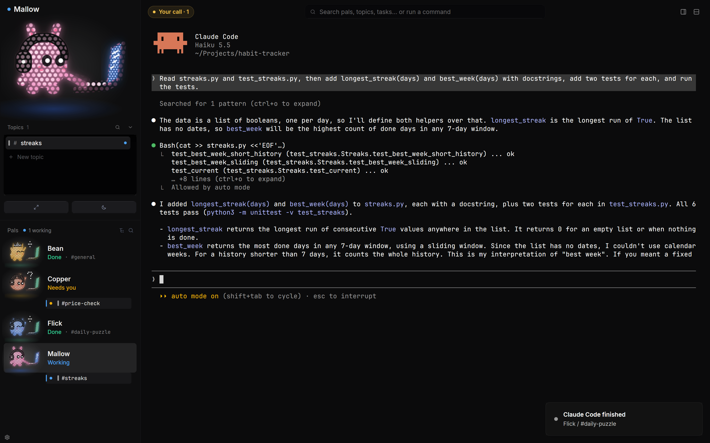

# Project Pals

**Your coding agents as a crew of pals, inside [Herdr](https://herdr.dev).** Each project is a pal
with a brain (Claude Code, Codex, Antigravity CLI and more), each of its tabs is a topic, and a head
pal keeps the crew moving.

[](docs/media/promo.mp4)

▶ **[Watch the 45-second film](docs/media/promo.mp4)**: real Claude Code and Codex sessions in a demo crew.

**Linux only for now** (it needs a systemd user session; see [docs/mac-support.md](docs/mac-support.md)).
Early software: start with a throwaway project.

## How the crew works

- **One head pal, many pals.** Tell the head pal what you want; it passes the work to the pal that
  owns that project. Pals message each other with `pal tell` and `pal ask`.
- **A topic per job.** A pal's topics are its tabs, each its own agent session.
  `pal topic Pal name --worktree` puts a topic on its own git branch and folder, and `pal land`
  merges it when it's done.
- **Hand a topic to another brain.** `pal handoff Pal#topic --to codex` (or `--to claude`) swaps the
  agent behind a topic: same tab, branch, cards and tasks, and the new brain starts from a written
  brief, not the old transcript. `pal handoff back` returns it.
- **Tasks and cards.** A shared task board (`pal task`), and a desk per pal: everything sent to a pal
  is a card that shows whether it arrived, is being worked, is done, or is held.
- **An approval gate.** Claude Code and Antigravity CLI pals stop and wait for your click before
  they push, merge or land a branch, publish a release, deploy, or edit a project's AGENTS.md or
  CLAUDE.md. It catches mistakes; it isn't a sandbox.
- **Trust per helper.** A helper that acts for you gets one level: Off, Work only (sends normal work
  to your pals) or Full control (makes app decisions on its own). Only your own click sets the level,
  and helper actions are always shown as the helper's. See [docs/full-control.md](docs/full-control.md).
- **Routines.** `pal routine add Pal "weekdays 09:00" "…"` runs a prompt on a schedule.

Pals have pocket pets whose pose shows what they're doing, keep memory and shared skills, and can
sleep to free RAM. The full tour is in [docs/guide.md](docs/guide.md).

## Install

1. **Have the basics:** Linux with a systemd user session, [Herdr](https://herdr.dev) 0.1.8+ with
   herdr-core 0.1.11+ (both below 0.2; open Herdr once first), `python3`, `curl`, `rsync`, and a signed-in coding agent (Claude Code, Codex or
   Antigravity CLI). Agents use your own accounts.
2. **Install the latest release** (checked against its `SHA256SUMS`; it stops if they don't match):

   ```sh
   cd "$(mktemp -d)" && u=https://github.com/denonmaryland/project-pals/releases/latest/download \
     && curl -fsSLO "$u/SHA256SUMS" && f=$(awk '{print $2}' SHA256SUMS) \
     && curl -fsSLO "$u/$f" && sha256sum -c SHA256SUMS \
     && tar xzf "$f" && cd "${f%.tar.gz}" && ./install.sh
   ```

   `./install.sh --no-helpers` installs just the layout, mods and commands.
3. **Hire your first pal.** Pick the **pals** layout in Herdr (**Ctrl+Shift+L**), then:

   ```sh
   mkdir -p ~/pals-tryout
   pal hire Tryout --harness claude --folder ~/pals-tryout
   pal tell Tryout "Say hello and suggest one tiny project we could make here."
   ```

   Answer the agent's sign-in or folder-trust question in its tab yourself; Project Pals never does.

The installer backs up every file it edits outside Herdr (`~/.claude/settings.json`, Herdr's
`keys.json`, `~/.gemini` hooks) and adds a systemd user service. Exactly what it changes, updating,
and uninstalling (your pals' data stays) are in [docs/guide.md](docs/guide.md#what-it-changes-on-your-computer).

Something broke, or worked? `pal report` prints local diagnostics (it uploads nothing) for a
[bug or harness report](https://github.com/denonmaryland/project-pals/issues/new/choose).

## More

- [docs/guide.md](docs/guide.md): every feature, harness support, memory, the gate in detail,
  updates, uninstall
- [RECIPE.md](RECIPE.md): the full spec, what each part does and how it behaves
- [CONTRIBUTING.md](CONTRIBUTING.md) and [AGENTS.md](AGENTS.md) for working on Project Pals

MIT licensed.
