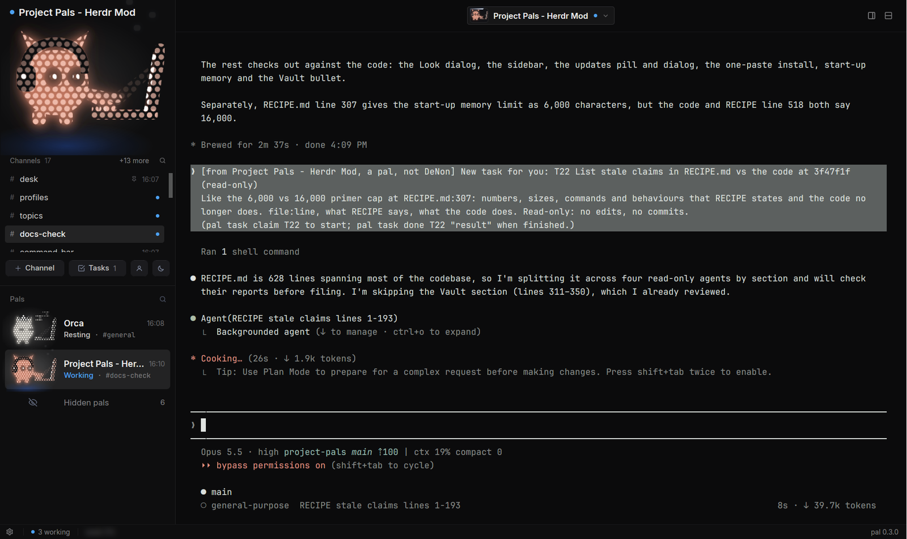

# Project Pals

A [Herdr](https://herdr.dev) layout that turns your coding agents into a crew of pals, in the
spirit of Grok's bots but for any harness: Claude Code, Antigravity CLI (`agy`), Codex, Grok CLI,
Gemini CLI, opencode, Hermes and more.

**Website:** [project-pals.vercel.app](https://project-pals.vercel.app)



**Linux only for now.** The helpers run as a systemd user service, so macOS (and WSL or containers
without a systemd user session) aren't supported yet. See [docs/mac-support.md](docs/mac-support.md).

Each Herdr space is a pal (a project with a brain), and each of its tabs is a topic. Pals can
work together in rooms. A head pal (Orchestrator unless you rename it) oversees the rest. On top of that you get:

- **Pocket pets:** every pal is a little LED critter whose pose shows what it's doing (working,
  needs you, done, PR open, merged, stuck, asleep). Pick its species, colour, what it wears and its
  eyes.
- **Terminal-first:** a topic is its agent's own terminal. Split it right or down, and answer the
  agent's questions right there.
- **A sidebar built for scanning:** the shown pal up top with its topics and quick actions, then
  every pal with its state in colour. Group pals into folders ("Personal", "Business"), pin them,
  and drag them into any order. Pin and reorder topics too.
- **Profiles:** a panel per pal with its mission, brain, memory, topics and tasks.
- **The Vault:** each pal's notes, with a live Home note: mission, focus, what's running, tasks,
  today's journal and the week, updating as work lands.
- **Tasks:** give a pal a task (with screenshots attached); it lands on its desk as a card.
  Routines run on a schedule.
- **Sleep (keep topics, free RAM):** a pal's agents stop while its topics' tabs and room seats
  stay; **Wake (resume topics)** starts them again where they were, resuming each topic's session.
  It never stops a pal that's working, asking you something, being typed to, or still running work
  of its own, and says why. **Close pal (end its space)** is the other way to rest one: its space
  closes and it waits under Hidden pals. (`pal sleep` / `pal wake` from the command line.)
- Hire pals and add topics on any harness, with a model per pal (cheap helpers on Haiku).
- Memory and shared skills, branch-per-topic review, and an approval gate.

## The Desk

Everything sent to a pal (a message, a question, a task, the answer to something it asked) is a
card with a status: queued, seen, working, done, held or needs you. You see when a pal actually
got it and what it did with it, instead of guessing from its screen.

- The header's **Desk** button shows every desk at once: what waits on you, what has no pal yet,
  what's held and why, then each pal and its topics. Move, raise, lower, close or cancel a card.
- **Ctrl+Shift+D** drops a card from anywhere. Pick a pal or topic, or **Auto**: a quick, cheap
  model (Claude Haiku) picks one for you, and a card it isn't sure about waits for you to place it.
- Claude Code pals get cards mid-step or when idle without anything typed into their box, so a
  half-written prompt stays put. Antigravity CLI pals get them between steps through hooks; Codex
  pals check with a `desk_check` tool; other brains get them typed in when idle.
- Pals work their desk with `pal desk` (`take`, `done "result"`, `reply`, `block`, `pass`).
  Cards are plain files in `~/.config/herdr-app/data/crew-desk`.

## Home

Click your head pal (or press **Ctrl+Shift+H**) for one page to come back to: everything that
needs you, oldest first, under one line saying who's working and what shipped today, or "All
caught up". While something needs you, Home shows one decision at a time: who's asking, the
context, what each option does and the asker's recommendation. Pick with a click or 1-9 (Enter
takes the recommendation). **T** opens your head pal's terminal, and "What happened today" opens
a drawer with what finished, got installed or was linked.

## MUSE, the idea partner

An optional pal to think out loud with. Hire it from the hire dialog (Idea partner) or with
`pal hire --partner`, then riff in its #ideas topic: half-formed ideas, screenshots. It asks sharp
questions and turns what you settle on into card drafts with the right pal suggested. Nothing goes
out until you click **Send** in the Desk's Drafts; then it's your own card. MUSE runs on Claude
Code (Sonnet).

## Harnesses

| Harness | Status |
|---|---|
| Claude Code | Tested daily: hiring, topics, model picker, hooks and the Desk's pals mod (cards handed over mid-step or when idle), the approval gate and status line |
| Antigravity CLI (`agy`) | Native (goodboimax's PR #1): hiring, topics, model picker, `-i` startup prompt, hooks (`SessionStart`, `PreToolUse`, `PreInvocation`, `Stop`), the approval gate (shell commands only; its file-edit tools aren't gated yet), shared skills |
| Codex | Tested as a pal. Shared skills work, and a `desk_check` / `desk_done` tool lets it check its desk; the approval gate and hooks are Claude Code and Antigravity CLI only, so cards are typed in when it's idle |
| Grok CLI, Gemini CLI, opencode, Hermes, others | Supported by the code as terminal pals. Hooks and the approval gate are Claude Code and Antigravity CLI only |

Reports from other harnesses are welcome.

## The approval gate

Claude Code and Antigravity CLI pals ask you before they push, publish, make a GitHub release,
merge or post on GitHub, deploy, send mail or webhooks, land a branch, run a repo's release script,
edit a project's AGENTS.md or CLAUDE.md, or write into Project Pals' message queue, your click
tokens or the Desk's cards. The command waits in your Inbox until you click Approve.

- It looks at the command as it runs: behind `npx`, a full path or `env`; inside `sh -c`, a heredoc
  fed to a shell, or a string that Python, Node, Perl, Ruby or PHP runs; file writes from those
  languages and from editors. A command that's only mentioned (a grep pattern, a quoted string,
  `--help`) isn't held. If the gate itself fails, the command is stopped, not let through.
- Settings, updates, roll back, landing and renaming need your click in Project Pals too, and only
  your click sends a message as you.
- **It catches mistakes, not a pal set on getting around it.** Pals run as you: a determined one
  could build a command from pieces or write a script and run it later. Antigravity CLI pals are
  gated on shell commands only: their own file-edit tools aren't checked yet.

## Install

Paste this in a terminal. It downloads the latest release, checks it against the release's
`SHA256SUMS` (it stops if they don't match), and runs the installer:

```sh
cd "$(mktemp -d)" && u=https://github.com/denonmaryland/project-pals/releases/latest/download \
  && curl -fsSLO "$u/SHA256SUMS" && f=$(awk '{print $2}' SHA256SUMS) \
  && curl -fsSLO "$u/$f" && sha256sum -c SHA256SUMS \
  && tar xzf "$f" && cd "${f%.tar.gz}" && ./install.sh
```

Or from a clone (to follow `main`, or to read everything first):

```sh
git clone https://github.com/denonmaryland/project-pals && cd project-pals
./install.sh            # or ./install.sh --no-helpers for just the layout, mods and commands
```

Needs Linux, Herdr (open it once first), `python3`, `curl` and `rsync`. Then switch Herdr to the
`pals` layout (Ctrl+Shift+L). Without a systemd user session the install still works, but crewd is
skipped: messages are typed in directly and routines and callbacks don't run.

## What it changes on your computer

Project Pals runs programs (`hc`, `git`, `claude -p` / `agy -p`) and reads files outside Herdr's folder.

- **Layout, mods and commands:** `~/.config/herdr-app/layouts/pals.json`, `mods/crew-*`, and
  `~/.local/bin/pal` and friends (`crew` is an alias).
- **Shortcuts:** Ctrl+Shift+I (profile), Ctrl+Shift+Space (command bar), Ctrl+Shift+D (drop a
  card) and Ctrl+Shift+H (Home) go into Herdr's `keys.json`, backed up first, and only where the
  key and the action are free.
- **Helpers (skip all with `--no-helpers`, or skip one harness's hooks with `--no-claude-hooks` / `--no-agy-hooks`):**
  - `herdr-crew.service`, the background helper.
  - Claude Code hooks and a status-line wrapper in `~/.claude/settings.json`, backed up first.
  - The Desk's Claude Code mod in `~/.claude/project-pals/pals`, loaded only by pals (with
    `--plugin-dir`), never by your other Claude Code sessions.
  - Antigravity CLI hooks (`project-pals`) in `~/.gemini/config/hooks.json`, backed up first, plus shared skill symlinks in `~/.gemini/config/skills`.
- **Memory reviews:** these send topic screens to Claude (Haiku/Sonnet) or Antigravity CLI (Gemini Flash; choose in About → Background model).
- **The Desk's Auto routing:** a card you drop with Auto is sent to Claude Haiku (else Antigravity
  CLI) with your pals' names and topics, at most 100 times a day. Turn it off in Settings → Desk.

## Hiring a pal into a new folder

The first time Claude Code runs in a folder, it asks **"Quick safety check: Is this a project you
created or one you trust?"** and waits for you. A pal hired into a folder Claude Code hasn't seen
(or a topic on a new worktree) stops on that question, and its first task starts only after
you answer it.

Project Pals never answers it for you: trusting a folder is your call. It tells you instead:
`pal hire` and `pal topic` print a notice, Herdr shows a toast (click it to jump to the tab), and
`pal overview` lists it under "Waiting on" until you answer. Open the tab and pick
**Yes, I trust this folder** (or **No, exit**).

## Updates

When a newer release is out, a quiet **Update available · 0.x.y** pill shows in the status bar.
Click it for the version and its highlights, then **Update now** or **Later** (the pill stays away
for 3 days for that version). The gear menu has **Check for updates** too. Project Pals looks at
most every 6 hours.

- Updates come only from this repo's GitHub releases, and must match the release's
  `SHA256SUMS`.
- Updates replace only Project Pals's own files. Your pals, rooms, memory, routines and tasks
  are never touched. Herdr reloads the mods by itself; nothing restarts.
- The previous version is kept for **Roll back** (in the update dialog after an update, and in
  Project Pals settings). If an install fails, the previous version goes back by itself.

From a terminal: `pal version` and `pal update check`. Installing and rolling back are buttons in
Project Pals: they need your click, so a pal can't start one.
A first install has nothing to roll back to.

## Releasing (maintainers)

```sh
./release 0.2.0 "What changed"
```

This bumps `VERSION`, tags it, builds the tarball and `SHA256SUMS`, pushes, and creates the
GitHub release.

## License

MIT
