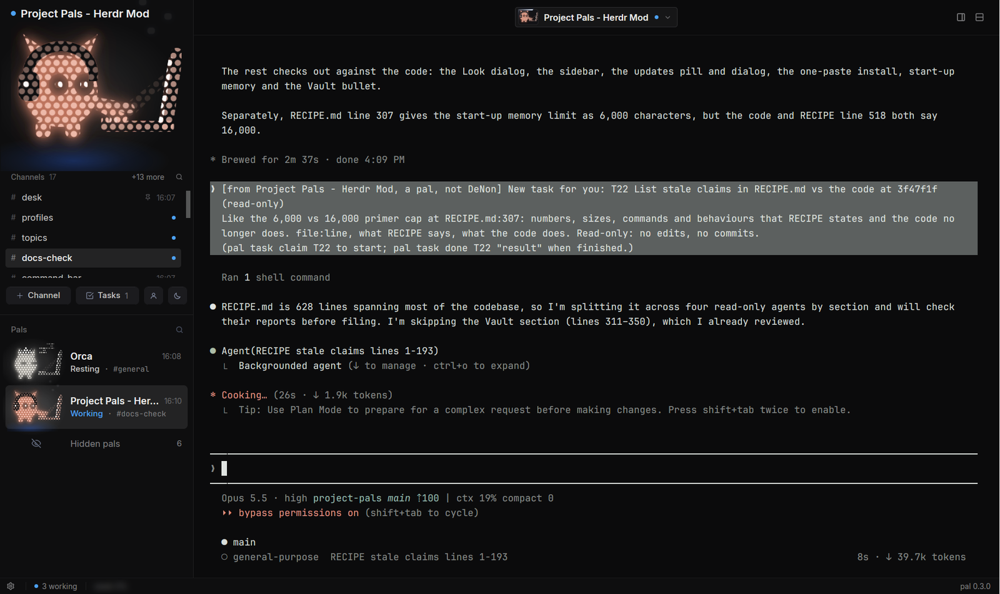

# Project Pals

Your coding agents as a crew of pals. Any harness works: Claude Code, Antigravity CLI (`agy`),
Codex, Grok CLI, Gemini CLI, opencode, Hermes, Copilot, Cursor, pi.

Every Herdr space is a pal (a project with a brain), and each of its tabs is a topic, a clone
working on one thing. Pals are pocket pets whose pose shows what they're doing. A topic is its
agent's own terminal. You can put pals together in group-chat rooms and give them tasks and
scheduled routines. Everything sent to a pal is a card on its desk (the Desk), and Home is the
one page that shows what needs you. A head pal (named Orchestrator by default; About → Settings
renames it) oversees everyone.

The layout updates itself from its GitHub releases.

## What you see

The window is one shell on the `chrome` background, with no title bar. The interface font is
Adwaita Sans, or Geist when Adwaita Sans isn't installed.

- **Sidebar** (left; 300px wide, drag between 56 and 440; under 160px it folds to a 64px rail of
  faces, each naming its pal on hover; its count at the top is what the Inbox counts, red when
  something needs you, hidden at zero):
  - Two round icon buttons at the top: fold, and search (opens the command palette).
  - **The head pal, on top:** a 64px living face, centered, with its name under it and a small status
    dot on the face.
  - **A pill switcher:** Pals · Rooms · Tasks · Inbox. Only Inbox shows a count, with a red or
    green dot, when something waits.
  - **Pals:** each pal is a 40px face, its name (14px, 500), and a one-line preview. The preview
    is its latest topic's terminal title, tagged `[topic]` when it has several. A mark shows
    only when something's happening: a wave while working, a green dot when it finished. A pill
    on the right counts its topics ("4 ch", shown from two up), or turns red ("1 blocked") when
    one needs you. Click a pal to open it; its topics are the tabs along the top, not rows
    here. Right-click a pal for Pin to the top, Rename (memory and routines follow: the roster
    remembers each space's name and runs `pal renamed` when it changes), Customize look, New
    topic, Sleep (keep topics, free RAM) / Wake (resume topics), Close pal (end its space; keeps the model it's on; Herdr asks "Close space?"). Right-click a
    sleeping pal for Wake / Unpin / Forget, a room card for Open / Close room. A pal hired in the
    last 10 minutes with no brain yet shows "starting". Pinned pals
    sit first, in the order pinned, with a small pin after the name and a hairline under them.
    Pals with no agent running fold into an **Asleep** row with a count; clicking a closed one
    wakes it with every topic it had, by name (records keep a tab id → name map).
    Each topic runs its brain: the command on record, else its brain on record started fresh, else
    Claude Code (as `pal topic` does), never bare shells; when nothing was on record it says which
    brain it picked and keeps it (T27). No brain to be had: a warning, and the topics open as shells.
  - **Rooms:** cards listing each room's members' faces and its goal, plus "New room".
  - **Tasks:** an "Add a task, @Pal to assign it" field, then bordered lists (Blocked, In
    progress, Open, Done today). Each task row shows its owner's face, its title and
    `T3 · Owner`. Clicking a task expands it: details, Open topic, Mark done, Cancel, Reopen.
  - **Inbox:**
    - Approval cards ("X wants to push", the command in monospace, Decline / Approve).
    - "X looks stuck" rows.
    - Finished and needs-you topics.
    - A banner if the helper service is off.
  - **Footer:** "+ Hire a pal", then icons for computers, routines (clock), About (ⓘ, with a dot
    when an update is out) and settings.
- **Frame** (padding 8/10, gap 6):
  - **Tab bar, 38px:** the shown pal's topics as soft pills, the only place topics are
    listed. The shown one is filled; each has a 7px status dot (yellow working, red needs you,
    green done, grey idle) and a name; ✕ appears on hover; double-click renames; a round + adds one.
    Right-click a tab (the `crew-menu` popup) to pin it, color it, rename or close it. Pinned tabs
    move to the front (`tab.move`, so Alt+number reaches them first), show a pin and no ✕, and a
    hairline follows them. Colors are the theme's own (ansi1–6 and accent, stored by name in
    shared `crew.marks`), so a colored tab follows the theme: its pill is tinted and its name
    takes the color. Every new topic gets one automatically: the palette color that looks most
    different (OKLab) from the ones its pal already uses, blue first. Clearing it in the menu
    keeps it plain. In a room, it shows rooms instead (overlapping faces, then `#name`).
  - **Sheet** (radius 18, the `surface` color, 1px border):
    - **Header, 52px:** one line: a 20px face, the pal name (dimmed), `/`, `#topic` (15px,
      500; click to rename). On the right: a status dot and word, and the details-panel toggle. In a room
      it's a centered pill: overlapping faces, then `#room`.
    - **Center stack:**
      - `tab-view`: the topic's terminal (padding 0/24, pane radius 12).
      - `room-view`: the room as a group chat. Your bubbles are on the right in the accent
        color; pals' are on the left with a 30px face and name. It's a centered column at most
        860px wide, with "• • •" typing bubbles.
      - (A `chat-view`, the topic read as a chat, was removed on 2026-11-08: Project Pals is
        terminal-first, and a real chat belongs to the native app.)
      - **Prompt card** (a floating block over `center`, bottom, centred): when the shown topic
        is blocked on a Claude Code permission prompt or question, its command and every option
        (Yes / Yes, don't ask again / No…) or the question's options; a click answers it (below).
    - **Composer** (rooms only; hidden while a topic is shown): an r8 box, "Message #room"
      (a draft per room), + to attach and send. Files can be dropped in or pasted as images.
    - **Details panel, 340px, hidden by default:**
      - A header: a 38px face (click it to change the look), the name, and
        "harness · computer".
      - The topic: name, folder and a branch tag, then "Take over terminal".
      - A 2×2 grid of stat cards: Context, Usage, Model, This session.
      - Own branch: Review and Land.
      - Other topics, Tasks, Routines, and Memory (a pinned-note field plus the three latest
        remembered facts).
- **Dialogs** (520px, sized to content, the `popover` color):
  - Hire a pal, New topic, New room, Routines, Look (the pet's colour), About.
  - Review (86% × 88%, a diff with line comments).
  - Attach (a 400 × 440 popup).
  - All share one look: a small header (face, 17px title, one dim line, ✕), a big name field in
    a rounded card, settings as one-line rows in a bordered list, and a footer with a quiet note,
    Cancel, and a filled pill button that's disabled until the form is ready.

## How it behaves

- **Status → face:**
  - working: the body bobs, the eyes wander, and a symbol cycles overhead (`…✦♪?✧…!`)
  - blocked: it bounces, with a red "!"
  - done: happy eyes and a sparkle
  - idle: calm
  - no agent: asleep, dimmed, with a "z"
- **The folder mascots are retired** (DeNon, 2026-11-08): no pal or brain shows one any more. Pals
  are their pocket pets; brains (harnesses) show Herdr's own program logos (`brainLogo()`:
  `knownAgents()` entries' `icon`, a one-colour glyph in #C8C8C8 when `tint`, else the picture;
  Herdr's `icons/<key>.svg`, or its neutral `icons/agent.svg`), 13-14px in the dialogs' selects and
  lists. The Look dialog (`crew-look`) is the pet's: a live preview of the pet in seven states
  (resting, working with its paw tapping, asks you, done, PR open, stuck, asleep dimmed), then its
  species (8), colour (16 swatches or a hex), what it wears (none or up to two of 10; a third
  replaces the older one) and its eyes (9), each choice shown as a resting thumbnail of the pet with
  it; Reset to its default, Cancel, Save (stores `pet` {species, acc, eyes} and `look.color`). No
  laptop choice: every state uses the same laptop, made of the pal's own LEDs turned down and seen
  from the pal's side (deck toward its paw, the lid leaning back, the screen facing the pal): the
  screen glows in the state's colour, shows code while working, and is shut while asleep; what the
  state is floats over it in LEDs (sparkle, ?, z, sweat). Under 46 px wide (`SMALL_BELOW`) a pet
  shows its head alone (`tileSvg`'s `small`, the `-s` files), with no paw frame or bits. (Redrawn
  2026-11-09: lit bodies with eyes and cheeks. DeNon the same day: no mouths; what a pal wears stays
  dark, as before; the laptop faces the pal, not you; nothing solid, everything in the one LED
  world. The folder mascots' `mascot-art.js` is gone.)
- **Scrolling** (DeNon, 2026-11-08: round scrollbars, not Herdr's hard-cut rectangle). A mod can't
  shape Herdr's scrollbar (no radius or width; its colours come from the theme) or read where a
  scroll area is, so every area our mods scroll is our own (`crew.js scrollArea`): it clips its
  content and moves it by an offset it keeps (wheel and trackpad in pixels, clamped to the measured
  view and content; at an end the wheel goes on to an outer area), and draws a 5px pill thumb,
  radius 2.5 (half its width), 3px in from the right edge in the padding every list keeps, at least
  24px tall, quiet (#FFFFFF26 dark, #0000002E light), brighter on hover and while dragged
  (#FFFFFF4D / #00000059), and draggable. The hero's topics, the pal list (and the folded rail),
  the Inbox's diff and proposal text, the profile panels (Overview, the tabs, the stage, the
  Vault), dialogs (task list, routines, update and About notes, attach, the review's file list,
  the selects' lists via `sheetPanelBox`) all use it. The two long virtual lists (the review's diff,
  a room's chat) keep their virtualisation: Herdr's bar is gone and the same pill is placed from
  the rows the list drew (`thumbFor`; dragging it scrolls to the row under it). No mod uses
  `overflow_*_scrollbar` or `Scrollbar` (a test checks). The command bar's results never scroll
  (they're capped to fit).
- **Pocket pets** (`lib/pets.js`, the engine from the pocket-pets study): every pal shows as a
  little critter in round LED dots, glowing in the pal's own colour (its look's colour, else its
  stock colour), drawn bare (no screen box, cropped to 138x108 of the 172x135 tile) at 96% of a
  **faint container**: `#131316` (one step up from the page), a 7% white hairline, radius
  max(4, w/35), the pet centred 4% high and free to break the edge. It replaces the folder mascot
  everywhere a pal's face shows: the Focus hero (no box at all, the sidebar's full width), the
  sidebar list (bare, no box or line: 75x59 in 68px rows over a soft radial aura that fades to
  nothing (`pet-aura.svg`, white at 9% in the middle, for the old box's depth), a small still pool of the state's colour
  under it instead of the edge loader; two lines, "status first": the name (600), then the
  state word in its colour (Resting, Working · 4m blue, Needs you amber, Done mint, PR open green,
  Merged purple, Closing red, Stuck amber, Asleep #808082; **working wins**: Working while any
  topic works, even when Herdr calls the pal done; Needs you beats both, and Done shows only when
  nothing runs: `crew.js palStatus`, for the word and the pet; DeNon 2026-11-08) and " · #topic" in 11px mono; 64px rows; half-opacity while the pal is closed or idle-hidden), rooms, dialogs.
  - **Pal list style** (Project Pals settings → Pal list style, `crew-palstyle`, saved as
    `palList` in crew-settings.json; DeNon 2026-11-08). The rows above are **Large pets**, the
    default. Nine compact looks from DeNon's board (`crew-boards/compact-pals`) use 22-34px pets
    (bare, a scaled aura, no pool) so more fits: 1 Name + folder (32px: name · time, state ·
    #topic, the folder in mono), 2 Two tight lines (26px: name · time, folder · branch; the
    state is a dot on the pet), 3 Name wraps (30px: the name may take two lines), 4 Rich detail
    (28px: name; folder · branch; the brain's logo from Herdr's icons, the state, "N topics" or
    "N blocked", "N tasks"), 5 Table (22px, one 32px line: dot, name, topics, open tasks),
    6 Progress (28px: a 3px bar of the pal's tasks, done today of done + open), 7 Folder first
    (30px: the folder relative to ~/Projects as the mono headline, the name small above, state ·
    branch), 8 Grouped (24px tight rows under the group headers), 9 Mini card (34px: a bordered
    card, the name may wrap, the folder, a state chip). All real data: the folder from the pal's
    record or space, the branch of the row's lead topic's pane, topic counts from its tabs, task
    counts from the board (open, claimed, blocked; done in the last day). Every look keeps the
    row's behaviour: a click opens the lead topic, right-click its menu, pins (the pin mark),
    groups and folding, drag to reorder, Hidden pals (a quieter 30px line in the compact looks)
    and the status-first colours.
    **Trees** (DeNon, 2026-11-08; `palTrees`, on unless false), an option for every look (it
    replaced the board's Tree look; a saved `palList: "tree"` shows as Two tight lines): a pal
    with a topic working or asking you unfolds its live topics under its row, asks you first,
    then working, then done, latest first, at most four and a 20px "+N more". They sit in a soft
    recessed channel (DeNon's pick, 2026-11-09, T75; `crew.js sunk "soft"`) that starts at the
    look's text column (`palstyles.js textLeft`): r7, no edge, only a touch darker than the sidebar
    (#0C0C0D; DeNon, 2026-11-10: much lighter than the Topics list's near-black well, so the two
    are clearly different), a thin dark line inside its top with a light shadow that fades over 7px, a very faint
    light line at the bottom (gpui-kit has no gradients or inner shadows, so these are 1 to 4px
    bands in a clipped box). Each topic row is 24px: the mark (the chosen working indicator, an
    amber dot when it asks you, a check when done) in a 16px slot on the left, the colour bar,
    "#topic" in 11.5px mono, and for a finished topic when it finished (11px #56565A) on the
    right. The shown topic is #18181A with #EDEDED text and a 2px blue edge. A click opens that
    topic, right-click is its menu. A pal with ONE live topic gets no channel (DeNon,
    2026-11-10: a single row in a box looks odd): the same row, same place, straight on the
    sidebar (`crew.js TREE_SINGLE`). Only the channel is added: nothing else moves. Resting,
    asleep and hidden pals never unfold.
    While a pal's tree shows (even one topic), its row drops " · #topic" and says only the state
    ("Working · 3m"), in every look; the row names its topic only when no tree rows are under it
    (resting, asleep, Trees off or folded). `crew.js treeShows` decides both.
    **No times** on pal rows (any look; DeNon, 2026-11-08): the name and the state line have the
    width; the state line keeps "Working · 4m". Trees rows show one only for a finished topic
    (2026-11-09, above). The hero's topic list keeps its times.
    **Fold all / unfold all** (DeNon, 2026-11-08): a 20px button in the Pals header, just before
    the search button, flips the same `palTrees` (so it's remembered and the Settings switch
    always agrees): unfolded it shows a tree icon ("Fold all topics"), folded a plain list
    ("Unfold all topics"). Same size either way, so the header never shifts. No per-pal folding.
    The sidebar and the dialog's preview draw rows with one renderer (`crew.js palLookRow` /
    `palLookTree`; the look list and its pure helpers in `lib/palstyles.js`, copied into every
    mod). The dialog: the ten looks on the left (number, name, pet size, a check on the chosen
    one), then the caption and the **Trees** switch ("Show working topics under each pal"); a
    live preview of your own pals in the look under the pointer (else the chosen one), with or
    without Trees, at the sidebar's width on the right; a click applies at once, Done keeps it,
    Cancel or Esc puts back the look and Trees you had. Unknown values fall back to Large pets.
    **Machine tag** (DeNon, 2026-11-08; `palMachine`: true / false, unset = the look's default):
    a pal on another machine gets a tiny tag after its name (the machine's laptop / desktop /
    server icon, amber when it isn't connected, and its name in 10.5px mono). On by default in
    Rich detail and Table, off elsewhere; the dialog's **Machine tag** switch sets it for every
    look (Cancel puts it back). No tag means this computer. A pal open on two machines (it moved
    and its old topics still run) is tagged in every look, "this computer" included.
  - Species (kit, bun, cub, fox, mochi, dino, owl, pup) comes from the record's `pet`
    (`{species, acc, eyes}`) or a hash of the pal's name; what it wears from its brain (Claude
    headphones, Codex glasses, Grok hood, Gemini antenna, Hermes scarf, OpenCode cap, other
    beanie); the head pal is a kit with the crown. The laptop is the profile one.
  - Eight states, each a pose plus the container's hairline at 40% of the state colour:
    **rest** (asleep or idle; z's, eyes shut; plain hairline), **working** (at the laptop, the
    lightsaber below), **asks you** (Herdr's blocked; "?", a mint edge that breathes), **done**
    (arms up, mint), **PR open** (holding a PR card, green), **merged** (cheering, purple),
    **closing** (waving, red: the PR closed unmerged in the last day), **stuck** (X eyes and sweat,
    amber: crewd says it's been working 15+ minutes with an unchanged screen). PR states show only
    while the pal is idle; merged and closing last a day.
  - Working moves natively: the paw taps (two frames cross-fade), from 44px wide bits drift up off
    the laptop, and a **lightsaber** laps the container's edge every 1.6 s: a white-blue core
    (`#EAF2FF`, 1.5-2 px, 100° comet tail) inside blue glow rings (`#4C8DFF` inside, `#2A6AFE`
    outside, 140° tail) that breathe (opacity 0.55-1 over 2.4 s).
  - Drawn on demand into `data/crew-pets/<hash>-<state>[-b].svg` (9 files a pet, about 12KB each)
    by the roster's art pass, which publishes shared `crew.pets`; the roster also publishes
    shared `crew.petstate` (stuck from `crew-health.json`, PR state from `gh pr list --head
    <branch>` on the space's machine, at most every 2 minutes per folder and branch).
  - Every pal has one (an old record's `"pet": "none"` gets the default). Until its tiles are on
    disk, an empty #131316 box of the same size holds its place.
  - **Pal look** (Project Pals settings → Pal look, `crew-pallook`, saved as `palLook` in
    crew-settings.json; DeNon 2026-11-09, the board is `crew-boards/pal-colors`). Two choices.
    **Pals**: Each its own (the default: a pal's own pick, else its brain's colour, else one from
    its name), All one colour (you pick), Split by count (2, 3 or 4 colours from one of three
    palettes, shared out as evenly as they go down the open pals in the list's own order, never
    "who needs you most", so a pal keeps its colour as its state changes; closed pals are split
    among themselves), By brain, By state (the pal itself takes the state's colour), By project or
    factory (a project is the part of a pal's name before " - ", else its folder; a factory gives
    its own colour), Match the theme (the theme's ANSI hues, following it). **Laptop screens**: By
    state (the default), Match the pal, Contrast pair (the hue across the wheel; a grey pal gets a
    cool white), Same for all (you pick; under Match the theme, the theme's accent until you do).
    A preset never changes a pal's record: its hand-picked colour shows under Each its own, and
    its own Look dialog always edits that colour. The dialog: the two lists on the left, each
    screen option tagged Best / Good / Weak for the chosen pet preset, and a line on why
    (`pallook.js pairFit`); on the right a made-up crew of 1, 4, 8 or 12, all in view, drawn by
    the real renderer. A click draws your crew's tiles in the new look first, then saves, so the
    sidebar never blanks; Done keeps it, Cancel or Esc puts back what you had. Pure logic in
    `lib/pallook.js` (`crewLook`), copied into every mod; `crew.js petOf` applies it, and
    `pets.js petSpec` takes `tones` (a colour per state) and `screen`. A pet without either keeps
    its old key and files.
- **Demo filter (for screenshots):** `data/crew-demo.json` `{"only": ["Website", …]}` makes that
  window's sidebar show just those pals, and `{"states": {"Website": "pr", …}}` shows those pals'
  pets in that tile state; no file, everyone, live. Screenshots come from a second Herdr window
  (`HERDR_APP_HOME` on a short path). Since 0.3.0, `preview.png` is `docs/media/overview.png`
  scaled to 1600 wide: that window on the real herdr-core, with a real agent working.
- **`pal hire --model <model>`** puts `--model` on the hired pal's command line.
- **Models:** Hire and New topic have a **Model** row for Claude Code (Your default · Opus ·
  Sonnet · Haiku) and Antigravity CLI (Your default · Gemini 4 Argon · Gemini 3.8 Flash · Claude
  Opus/Sonnet · GPT-OSS; New topic adds "Same as <pal>"). It goes on that command line as `--model`,
  never through `/model`, which would change the default for every session. Antigravity CLI initial
  tasks are passed via `-i <prompt>` rather than positional args so interactive sessions stay alive.
- **Hire / Add topic / invite:** a pal or you runs `pal hire|topic|invite` (`pal channel` is the same as `pal topic`). That drops a
  request in `data/crew-requests/`, which the roster carries out with `space.new` / `tab.new`
  and answers with `<id>.result.json`. Your view stays where it was.
  A new topic always starts a brain (T24), picked in this order: `--harness`, the pal's own
  command line, the brain it runs or was seen running (`rememberBrains`: a record without one
  learns it while the pal is awake), a brain one of its topics used, the asking pal's, else Claude
  Code. A guess is said ("its own brain isn't on record, so this uses yours") and kept for that
  topic. A brain that can't start is an error, never a bare shell that drops the brief. `pal topic`
  then waits up to 20s for the agent and says plainly if none came up.
- **Rooms:**
  - Messages are lines in `data/crew-rooms/<room>.jsonl`.
  - Pals post with `pal-room say`, and @mentions deliver. A pal's message lands after a typing
    delay (1.5s + 45ms per character, capped at 9s).
  - After 12 pal messages in a row, room messages stop being delivered until the owner posts.
  - Inviting an asleep pal wakes it in a new `#room` topic.
- **Sleep (keep topics, free RAM) and Wake (resume topics), in place** (PR #4, goodboimax; 0.4.1):
  - `pal sleep <Pal|Pal#topic|#topic>` or `--idle` stops the agent in a topic and keeps its shell,
    tab and room seats. In the app: a pal's right-click and pal menu (Sleep (keep topics, free RAM) /
    Wake (resume topics)), a topic's right-click (Sleep this topic / Wake this topic), a room's
    (Sleep all / Wake all, its seats only). They run `pal … --notify` detached; the outcome comes
    back as a toast (`power-report` request), refusals with their reason. Close pal (end its space)
    is the other rest: it closes the space (it was "Put to sleep" before 0.4.1).
  - It refuses, saying why, and has no `--force`: working (or "esc to interrupt" on screen), blocked
    or a folder-trust prompt, unsent text in its box, an input box it can't read, a message being
    handed over, or work the agent still runs itself (a descendant started more than 20s after it,
    seen twice 1.5s apart, at any depth, a helper's later children too; Claude Code's "N shells still
    running"). `--idle` skips the head pal, and naming it needs the owner's click (the menus send
    one, a one-time token for exactly those arguments).
  - Only this machine's pals, and only the one known agent (`claude`, `agy`, `codex`, …) directly
    under the topic's shell, with `HC_TERMINAL_ID` naming that terminal in both the shell's and the
    agent's environment. It's pinned with a pidfd and checked again before any signal. TERM, a 5s
    wait, then KILL only if it's still there. A dev server or editor in the tab is never touched.
  - Sleep writes `data/crew-slept/<terminal>.json` (the session link it had); crewd forgets markers
    of gone terminals.
  - `pal wake` asks the app for the brain (`wake-brain`, T27's order per topic: the topic's brain on
    record, the pal's command on record, its harness started fresh, else Claude Code) and types it
    into the bare shell (nothing else may run there). It resumes (`claude --resume <id>`,
    `agy --conversation=<id>`) only a session linked by the hook, unchanged since it was put to
    sleep, of the brain being started, in the folder the shell is in (Claude), and not open in
    another topic; else it starts fresh with the primer hint and says why. Never `--continue`.
    `pal wake Pal` wakes the topics `pal sleep` put to sleep, else its room seats, else its active topic.
  - Messages: crewd never types into a bare shell. Cards queued for it go back to the Desk, held:
    asleep, and are delivered once an agent runs there; messages without a card wait in the queue.
  - agy doesn't clear its Herdr status (OSC 7501) when it exits, so a dead agy tab looked awake.
    Sleep, and crewd for any agent tab whose shell has no children left, write
    `\e]7501;state=clear\a` to the shell's terminal.
- **Helper (crewd, optional):**
  - Messages wait for a pal's turn to end.
  - Whoever handed out work is told when it's done.
  - Stuck topics (15 minutes of an unchanged screen) get flagged.
  - Routines run on schedule; a reply of NOTHING_NEW stays quiet.
  - A cheap model (`claude -p` or `agy -p`, chosen in About → Background model: `pal settings llm` with the owner's click) reviews topics to save memory notes, distilled nightly.
  - Pals' replies (for `pal ask` and the "finished what you asked" callbacks) are read from Claude Code (`~/.claude/projects/…`) and Antigravity CLI (`~/.gemini/antigravity-cli/brain/…`) session files, through `crewchat.py`.
  - It checks for updates every 6 hours at most (`crewupdate.CHECK_EVERY`).
- **Approvals:** with the Claude Code or Antigravity CLI hook, these are held for the owner's approval in the
  Inbox: push, publish, release, PR merge or create, GitHub posting, deploys, messaging, and
  `pal land`. An approval lets that exact command through once.
- **Updates:** the status bar's quiet **Update available · X** pill (a 18px raised rectangle,
  a 6px blue dot, 11px #808082 text; while an update runs, a spinning ring and "Updating to X")
  or the gear's **Check for updates** opens `crew-update`, an A-style sheet: the head pal's pet,
  "Project Pals X is out" over "You have Y · released <date>", the release notes' bullet
  highlights (bold headline, one truncated line of detail, at most 6; the "### Fixed" part is
  left out), Full release notes →, a shield line saying what happens, then **Later** (hides the
  pill for that version for 3 days: shared `crew.update.later`) and **Update now**. Update now runs
  `pal update apply --json` detached (`updateStart`): it downloads the latest release of the repo
  in `pal.json`, checks it against `SHA256SUMS`, snapshots the installed files, runs `install.sh`,
  and restores the snapshot if any mod fails `herdr-app check`. It writes its progress to
  `data/crew-update-run.json` (`running` with a `step`, then `done` or `failed`), which the pill
  and the dialog read, because the update reinstalls the dialog itself; a run silent for 15
  minutes counts as failed. After it: "Updated to X" with Roll back. The status bar also asks
  GitHub when the last check is over 6 hours old (at most once an hour), for installs without
  crewd. The gear's **Check for updates** and About's button always ask GitHub (`Cache-Control:
  no-cache`, nothing cached of ours); an open About or `crew-update` asks again by itself once the
  last answer is over 10 minutes old (`checkDue`, at most once per 10 minutes), not only when it
  opens. Both say what GitHub's newest was and when they asked ("You have 0.4.0. GitHub's newest:
  0.4.1 · checked 15:48", `checkLine`); a failed check keeps the last answer and records `tried` and
  `error` in `crew-update.json`, shown as "Couldn't check for updates". Every `pal update check`
  is a line in `data/crew-update.log` (T64: an About left open since the 0.4.0 update still said
  up to date after 0.4.1 shipped). Snapshots store Herdr's home as `@app/…` (it needn't be inside `$HOME`); Roll back still
  reads older snapshots stored relative to `$HOME`.
  A local `./install.sh` over an existing install takes the same kind of snapshot first
  (`update-from-<version>-local-*.tar.gz`, the last 5 kept), so Roll back always undoes the most
  recent install, not an older release update.
- **Supported Herdr** (T48): `pals.json` `"herdr"` gives `{min, tested, below}` for `app` (herdr-app)
  and `core` (hc): 0.1.8 / 0.1.14 / 0.2 and 0.1.11 / 0.1.19 / 0.2. `install.sh` runs
  `bin/crewcompat.py` first: outside min..below (or a missing / unreadable version) it prints a
  boxed WARNING with the supported line to stderr and installs anyway; newer than `tested` but below
  `below` prints one `note:` line. `crew-install.json` records `herdr: {app, core, supported, warn,
  range}`; About shows the first warning in red under the status when `supported` is false; `pal
  version` checks the Herdr on PATH against the recorded range.
- **Uninstall** (T48, T57): About's footer has Uninstall beside Roll back. It asks in place ("Uninstall
  Project Pals?" in the blocked color, Keep it / Uninstall), then runs `pal uninstall --json` with
  the owner's click token. `./install.sh --uninstall [--purge] [--dry-run]` runs the same code
  (`bin/crewuninstall.py`) from a checkout. `crewuninstall.uninstall()` itself checks the owner on
  every non-dry run, whoever calls it: a one-time click token for exactly its arguments
  (`["uninstall", …flags]`; pal passes its own `owner_args()`), or, with no click, "uninstall" typed
  on `/dev/tty` (opened with `os.open`: a text `"r+"` open fails on a tty) when nothing above it is
  an agent (`agent_above`, T58): not `HC_TERMINAL_ID`'s terminal, and, walking `/proc` parents, no
  ancestor whose `comm` is an agent program (`AGENT_COMMS`) or whose own environment's
  `HC_TERMINAL_ID` has an agent status (`hc get --json` `.status`; unknown counts as an agent). That
  refuses a pal's `expect` / `script` / pty even after `env -u HC_TERMINAL_ID`. A pal's shell has no
  controlling terminal. `--purge` prints `purge_list()` (the `data/crew-*` names, backups, cache)
  before asking. Refused: exit 3, nothing changed. `--dry-run` needs neither. The gate's
  `uninstall-indirect` check (`crewguard.runs_uninstall`) holds a pty wrapper (`expect`, `script`,
  `unbuffer`, …) on a line naming `install.sh … --uninstall` or `crewuninstall`, and interpreter code
  importing `crewuninstall`, naming `CLICKS` / `click_ok`, or running the uninstall under a pty.
  Herdr's home itself, and every folder between `$HOME` and it, must not be a link
  (`app_home_unsafe`).
  Every delete and write goes through `unsafe()`: each folder between Herdr's home or `$HOME` and
  the path must be a real folder resolving where its path says; a last-part link is unlinked; a
  config file that's a link is never written (temp file `O_EXCL | O_NOFOLLOW`, then rename). What's
  refused is reported in `notes`. `install.sh` ends with `crewuninstall.py record-installed SRC`
  (the manifest, `crew-footprint.json` `installed`); uninstall removes only listed paths, and for an
  install without one, only paths whose content is Project Pals' (`crew.js` starting `// Project
  Pals`, a bin with a marker, …). Hook entries are ours only when the command is exactly
  `~/.local/bin/crew-hook[-fast] <event>` (install-hooks.py, Roll back and uninstall alike). Order: stop
  and disable crewd and remove its unit; take Project Pals' entries out of `~/.claude/settings.json`
  (crew-hook entries, the crew-statusline wrapper back to its original command or gone),
  `~/.gemini/config/hooks.json` (`project-pals`) and `keys.json` (only install's exact key → action
  pairs); remove skill links into `data/crew-skills`, `~/.claude/project-pals`, the commands and
  old-name links (only Project Pals' own), `~/.local/lib/herdr-crew`; switch Herdr from `pals` to
  `main` and close Project Pals' open dialogs (top first, until none is `crew-*`); remove
  `layouts/pals.*` and every `mods/crew-*` holding `crew.js`; remove install's bookkeeping
  (`crew-install.json`, `crew-footprint.json`, `crew-originals`, `crew-clicks`, `crew-update*.json`,
  `crew-statusline-original`); remove folders install created once empty. `--purge` also removes
  `data/crew-*` (not a non-empty `crew-worktrees`), `agy-models.json`, `~/.cache/project-pals` and
  `.crew-backups`.
  To make that exact, every install first runs `crewuninstall.py record`: it notes which of the
  paths it touches existed (first time each is seen only) and copies `keys.json`,
  `~/.claude/settings.json` and `~/.gemini/config/hooks.json` to `data/crew-originals/` while they
  hold nothing of Project Pals'. Uninstall writes a copy's exact bytes back when the cleaned file
  equals it; otherwise it keeps the person's later edits and backs the file up to
  `.crew-backups/uninstall-<time>/` first.

### The layout: Focus

One shape, Focus: DeNon removed the Pro view (pal rail, list column, tab strip, inspector and the
switch) on 2026-11-08. Anything new is drawn in the design-system look: 1px hairlines, radius 3/4/6/8,
rectangular segments and tags.

- **Pal groups and order** (DeNon, 2026-11-08, like Grok Bot's): the head pal on top, then named
  groups ("Personal", "Business", …) under small grey headers (11px #6A6A6C name, #56565A count,
  14px of air above) that work like folders: hovering shows an r4 pill and a chevron on the right,
  a click folds the group away or opens it (remembered in `crew.marks.collapsed`),
  then "Unassigned" (where new pals land); with no groups made, no headers at all. Inside a group:
  pinned pals first (pin order), then your order, else who needs you most. **Drag** a pal (press,
  move 5px): it dims and a 2px blue line shows where it lands (above or below the row under the
  pointer; on a header, first in that group; an empty group shows "Drag a pal here"), release
  drops it, leaving the list cancels. Right-click a pal: Pin, Move up / Move down, and a Group
  section (each group, Unassigned, New group…). Right-click a group header: Rename…, Move up /
  down, New group…, Delete group (its pals go to Unassigned). The gear menu has New group… too.
  Saved in shared `crew.marks` (`groups`, `pals[bot].group/order/pin`, `arranged`), so it
  survives restarts; Herdr's own space order isn't touched. The topic list can't drag: it's a
  virtual list, whose rows can't take their own mouse handlers in Herdr.
- **Dialogs** ("A · Compact sheet", DeNon 2026-11-08): New topic, Hire a pal, New room, New group
  and Tasks share one kit (`sheet*` in crew.js): a header row (the pal's bare pet over its aura, a
  15/600 title, a 12px #808082 line, a quiet ×), 32px r6 fields on #0A0A0B with a #2C2C2F hairline
  ("#" prefix for names), quiet multi-line boxes, one row of compact 26px selects (label #6A6A6C,
  value #C8C8C8, chevron) whose list opens under the row, and a footer with a hairline over it: a key
  hint, Cancel and the primary action as pebbles (the primary a step brighter, steel blue #26364A;
  dimmed until it's ready). New topic puts Category behind its own select; Hire's selects are
  Brain, Model, Role and Computer, then the folder (with Browse) and the first topic.
- **The Focus grid:** content (text, icons, pets) starts 16px in; row backgrounds, the topic
  rows and the quick-action buttons sit 8px in from both sides. Text ladder: names #EDEDED,
  previews #C8C8C8, `[topic]` 11px mono #808082, times #6A6A6C; a closed pal's text never goes
  below #808082 (its pet dims instead). The list ends with 24px of padding.
- **Focus:** the sidebar at 304px (the hero pal and the pal list, as above), no tab strip.
  - **The hero** (hero v2 "2 · Floor", DeNon 2026-11-08): no box. The shown pal's pet and its
    laptop at 90% of the sidebar's width, centred (273x214 at 304; the critter about 165px), drawn on the
    sidebar itself over the same soft aura (its own "open" tiles, `-o.svg`), standing on a floor: a pool of the state's colour under the pet (no line: DeNon took it out) (`pet-floor-<state>.svg`:
    working blue, done mint, asks you amber and breathing, PR green, merged purple, closing red,
    stuck amber; none at rest or asleep). Nothing moves along the floor (a saber there was tried
    and removed: DeNon found it annoying). The name (16/600) sits in a 30px band at the top, 14px in, the sprite
    starting 8px into it (bun ears, antennas and crowns reach the sprite's top edge, so the name
    can't sit on the sprite), with the full width so it never cuts off: a 7px state dot before it (blue working, amber
    asks you / stuck, green done / PR); no state word (DeNon took it out; the tooltip names it).
    Under the floor, the pal's topics at full width: a header ("Topics", the count, and a
    magnifier: a search box that filters as you type; Esc or × clears and closes it), then 28px
    rows (`#`, the name, the working indicator or an amber dot, a green check or when it last changed), up to
    four, in a recessed well (DeNon's pick, 2026-11-09, T75; `crew.js sunk "deep"`): 8px in from
    each side, r8, #030304 with a dark edge, a shadow under its top that fades over 31px and a
    faint light line at the bottom; the rows start 4px down and 4px in. The shown topic is a
    raised tile (`raisedTile`: #1A1A1C, r5, a light line inside its top, a small shadow). The box
    is ALWAYS four rows plus the 12px peek (132px, edge included), whatever the pal has,
    so switching pals never moves the quick actions or the Pals list (DeNon, 2026-11-08): fewer rows
    leave the rest blank, with a faint "+ New topic" row (#56565A, opens the New topic dialog) after the last
    when not searching; past four the box is four rows plus the top 12px of the
    fifth, cut at its edge, scrolling in our own area with the pill thumb (see Scrolling below; the
    rows end 13px in and the pill sits in that gap, never over a time, pin or dot). No "+N more"
    in the header (DeNon, 2026-11-08): "Topics 18" says it, and the cut row, the pill and the
    fixed box show there's more. The
    shown topic is scrolled into view when it changes. **Topic colours:** a 3x12px bar with
    round ends just before each "#" (here, in the Trees rows and in the topic picker), in the
    topic's saved colour (right-click → colour); no colour leaves the slot empty, so names never
    move (`crew.js topicMark`; DeNon 2026-11-08). The header's last button, a 22px chevron
    after the magnifier, folds the list to the header alone ("Topics 18 · 3 working · 1 needs
    you"), and unfolds it. It's ONE remembered state for every pal
    (`heroTopicsFolded` in crew-settings.json; DeNon, 2026-11-08), so folded or not the hero is
    the same height whoever you switch to. Opening the search unfolds it. Order: pinned topics first (in pin order,
    with a small pin mark), then, once you've arranged that pal's topics, Herdr's tab order, else
    the smart order (needs you, finished, working, idle agents, plain shells). Right-click a topic:
    Pin / Unpin, Review changes (a worktree topic only: `crew-review`), and Move up / Move down
    (within its group). Pinning and moving move Herdr's own tabs
    (`tab.move`), so the order survives restarts and the `crew-pick` dropdown lists the same.
    The working indicator (here and in `crew-pick`) is the owner's pick in Project Pals settings →
    Working indicator (`crew-indicator`, saved as `workingIndicator` in crew-settings.json): Classic
    dot (6px blue, the default) or one of 30 looping animations in four groups, Pixel (10 dithered
    spinners, 12px), Sphere (10 shaded spheres, 12px) and ASCII (10 character globes, 16px). They
    are animated WebPs in `mods/crew-roster/working/`, pre-rendered from DeNon's three design boards
    by `tools/working-indicators/build.sh` and played by Herdr natively; only working rows draw
    one. The dialog: fake topic rows on top showing the style under the pointer (else the chosen
    one), then a grid of 44px tiles with live 24px previews per group; a click applies at once,
    Done keeps it, Cancel or Esc puts back the one you had.
    No dragging: Herdr's lists have no row drag, so there is no hover pin either; each row takes its
    own click and right-click. Then four quick actions as subtle "pebbles" (Inbox and
    Tasks share the row evenly, flex-basis 0, and each keeps an 18px slot for its count even at zero,
    so no count or pal switch changes their widths; Profile and Sleep are 28px squares) (one flat #1B1B1E face, a 6% white
    hairline inside the top, a 1px darker line inside the bottom, a thin dark outline, GPUI's faintest
    shadow, 28px, r7, 9px side padding; hover a shade lighter, press a shade darker, nothing moves;
    `pebble()` in crew.js): Inbox (DeNon, 2026-11-08: it took "+ Channel"'s place; an inbox icon,
    the sidebar's Inbox view, a second click goes back to the pals; its count is what needs you,
    the status bar's "N need you" from shared `crew.needs`, amber #F0C04A when any, blank at zero;
    New topic is still the list's "+ New topic" row, the command bar and the right-click menu), Tasks with this pal's open count, an icon-only Profile (the profile panel, below;
    Ctrl+Shift+I; the hero's name, underlined on hover, opens it too) and an icon-only moon (put to
    sleep; Herdr asks first). Tasks (Tell merged into it: DeNon, "a Tell is really a task") opens `crew-tasks`
    (520px): a composer on top (a 13.5px textarea, 3 rows growing to 10; Enter adds, Shift+Enter is
    a new line; images by pasting, dropping files on the dialog, or the paperclip's recent-files list,
    copied into `data/crew-attachments`, images only, 10MB and 6 per task, shown as 64x48 thumbnails
    with ×). Adding makes a real task on the shared board, `pal task add "<first line>" --for <pal>
    --body "<the rest, and the images' paths>"`, marked from the owner; the pal is told when its turn
    ends and its "New task" message carries the body, paths included. Then that pal's open tasks
    (working first, then blocked, then open; a tick finishes one, a click on its title shows its
    details, notes and who asked), and "All tasks on the board →". Quick questions go in the
    terminal. No state pill, no species/brain line; the task text is in its pal row. The header has the
  command bar's field centred (T18; DeNon: "this pill is redundant maybe it should be a global
  search / command type of thing, the things that are in the dropdown already there are perfect"):
  a quiet recessed field up to 520 px wide (DeNon: no pet in it; h30, r7, a shade darker than the
  header (#08080A), a faint dark line inside the top, a very faint light one inside the bottom, no
  outer shadow; hover a touch lighter; a subtle blue inner ring while the command bar is open,
  shared `crew.command.open`), a magnifier, "Search pals, topics, tasks… or run a command" and
  its shortcut as a tiny raised pebble (`keyCap`); a click or **Ctrl+Shift+Space**
  (`crew-header.search`) opens the command bar over it (below).
  The split buttons are on the right; the git branch is in
  the agent's own status line instead (crew-statusline adds a dim "(worktree)" in a linked worktree,
  or prints the branch when you have no status line of your own); no
  topic picker on the left (DeNon took it out: topics switch from the hero's list, which shows
  "no agent"). Under it, the topic's terminal, and nothing on the right (DeNon, 2026-11-08, after
  Grok Bot).
- **The profile panel** (DeNon, 2026-11-08; `docs/profiles/proposal.md`): a right-side panel,
  hidden by default. It opens from the hero's name, the Profile quick action, right-click a pal →
  Profile, the pal menu, or **Ctrl+Shift+I** (`crew-roster.profile`); Esc while the panel has the
  keyboard, its × or the same trigger again close it, and the terminal gets its full width back.
  Esc in the terminal stays the program's (it interrupts Claude Code). It always shows the shown pal.
  - Two sizes: **Side**, beside the terminal (420 px by default; drag its edge, 360-640,
    remembered as `focus.panelPx`), and **Full** (⤢ in its header: it hides the `work` column, so
    the panel fills everything right of the sidebar). Profile opens Full, the project tabs Side;
    each tab remembers its size. It starts hidden on every launch.
  - **The profile page** (DeNon 2026-11-08: a mix of #1 Hero stage and #5 Mission control from
    `data/crew-boards/profile-directions`; `stage.js`, numbers from `stagedata.js`). **The hero:**
    the pal is the star: its pet on the soft aura, standing on a stage lit in its state's colour
    (blue working, mint done or PR open, amber asks you (breathing), red stuck; no light at rest or
    asleep: a hairline under the stage instead); a pool of the same colour under its feet; the
    state line over it in mono ("Working · 12m in #profiles": the shown topic); the name big under
    it (22/700; 17 in Side); the mission as one quiet line (else the role; a click opens Vault ›
    Mission); then the **composer**, "Give <pal> a task…" (`compose.js`): it does what the Tasks
    dialog does: Enter adds a real task for the pal (`pal task add --for`, told when its turn ends),
    Shift+Enter is a new line, images by paste, drop on the hero or the paperclip (6 at most,
    `crewattach.py`). Each pal has its own draft; Esc doesn't close the panel over a half-written
    one. **The week cards** (four, r8, tinted fill and edge in their colour): **Shipped** (mint: the
    pal's tasks done in 7 days; opens Vault › Home), **In motion** (blue: working topics plus
    claimed tasks not on one; shows the working topic), **Needs you** (amber: asking topics,
    commands held for approval, proposals, stuck topics; shows the asking topic, else the
    Inbox), **Hiccups** (red: the notebook's hiccups in 7 days and the minutes they cost; opens
    the Journal). Side: a compact hero (92 px pet) and the cards 2×2, then the sections below.
  - **Which computer it works on** (DeNon 2026-11-08; `lib/machines.js`, `crew-machine`). The
    roster publishes the machines as shared `crew.machines` every 20 s (`hc machine ls --json`,
    plus this computer's host name and laptop-or-desktop from its battery). The hero has a machine
    chip under the mission (icon, name, host; an amber dot when it isn't connected; "→ new topics
    on <m>" after a move); a click opens **Change machine…**. The **Machine** card (Full: a panel,
    Side: a section above Facts) shows the machine (icon by kind: a saved
    `machineKinds[<name>]`, else from its name, else server), its host, how Herdr reaches it
    ("this computer (local)", "SSH via Tailscale · user@100.x" for Tailscale's 100.64/10 or
    *.ts.net, "SSH", "via <command>"), connected or not, the project folder on it; when new
    topics start elsewhere, a blue note with Open one there; each of the pal's spaces on other
    machines ("also running: N topics", Show); Change machine…. A pal open on two machines lists
    its topics from both, each with a machine tag.
    **Change machine…** (a 560 px sheet): this computer, then every added machine (icon, name,
    host · connection · target, the state dot and word, "new topics start here", "N running");
    Add machine… (`hc machine add <target> --name <name> --json`, or Herdr's Machines settings);
    then the **project folder on** the picked machine (what it had there before, else the same
    path under that machine's home), checked there (`test -d` run on it, 0.7 s after typing
    stops; an offline machine says it can't look), with **Clone it there** (`git clone` of the
    project's origin, run there) and, on this computer, **Choose folder…**; a warning when the
    pal's brain isn't installed there. Move to <m> (ready once the folder is found) saves the
    record: `machine` (where new topics start and where it wakes), `folder`, and `folders` (the
    folder per machine, "" for this computer, for moving back). Terminals can't move: running
    topics stay where they are, and the sheet says so. Then **Open a topic on <m>** (an awake
    pal) or **Wake on <m>** (an asleep one). Every new topic (+ Topic too) goes through
    `openTopic`: a tab in the pal's space on that machine, else a new space there with the pal's
    name, linked to the record as `also`, so it stays one pal (`recordOf`, `sleepers`,
    `palSpaces`); `linkRecords` forgets closed `also` spaces and hands over to one when the pal's
    own space closes.
  - **Profile in Full is the dashboard** (`profile-dash`): the header with the tabs inline, ⤡ Side
    and ×; then a row: the **stage** (`dash-stage`, scrolling: the hero across its width, the four
    cards in a row, then calm panels (#161617, r8, a 34 px mono header): **Topics** (live state
    dot, or hollow for no agent; `#name` and how long; what it's on; branch or `worktree · <branch>`
    with Review; a click points the terminal at it; + Topic), **Tasks** (Now · Blocked · Next ·
    Done · 7 days: the pal's tasks, plus each working topic without a claimed task, asking and
    stuck topics; a task opens to its body, result and Mark done / Reopen; All tasks opens the
    dialog), **Vault** (Home, Mission with its done-when count, Journal with today's entries,
    Brain with its decision and change counts; a click opens that note), **Memory** (as in Side,
    with Remember… in place), **About** (role, facts, routines with Manage, the quick actions); in
    1, 2 or 3 columns by width) | the **mini terminal** column (`dash-right`, 460 px, min 320,
    resizable): a 33 px bar (`TERMINAL`, a `#topic ▾` picker, live, program and state, Open
    topic ↗) over `dash-term`, an `{agent: "focused"}` block showing the shown topic's agent:
    the real session, typed into directly. A topic row, a task's topic or the picker points
    it at another topic (`tab.select`, then `agent.focus`). A topic with no agent hides the
    terminal; the bar then fills the column and says so, with Wake for a sleeping pal.
  - Header (52 px, #0E0E0F, a hairline under it): the pal's 30 px pet, its name (14/600), ⤢ / ⤡
    and ×. Tabs (36 px, r4, the shown one #232324): **Profile · Vault** ‖ **AGENTS.md** (a 1 px
    divider between the pal's tabs and its project's; AGENTS.md carries the lint's badge:
    red errors, amber warnings, a blue + when a fix is offered). Esc leaves an edit or a review
    first, then closes the panel.
  - **Profile** (Side): the compact hero and the 2×2 cards (above); Facts (role, click to change:
    the record's `role`; brain and `--model`, folder, machine, branch, pet, hired by); every topic
    (its state dot, or a hollow one with no agent; what it's on, else its brief; `worktree ·
    <branch>` and Review on worktree topics; click shows it); **Memory** (the pinned note,
    editable and saved on blur; what a new session starts with and what the 6,000-character primer
    cap cuts; MEMORY.md; the last two days of notes; how many facts about the owner it shares;
    Remember…, saved as `pal remember --bot`; Open folder); its routines; and Tasks (the
    `crew-tasks` dialog), + Topic, Customize look, Close pal, as pebbles.
  - **Vault** (DeNon 2026-11-08: it replaced the Notebook, Mission and Brain tabs, which are now
    its notes; their old keys still open them, e.g. `openPanel("mission")`). Opens Full. Full: the
    file tree (232 px, #0B0B0C: Home with a mint live dot, Mission, Journal with its day count (the
    days with entries in the last 14), Brain › Decisions / Change log / Map (left out when AGENTS.md
    has a layout section) / All brain files, Notes (up to 12), then On disk with the folder, "Plain
    markdown: it opens in Obsidian." and Open folder) | the note (max 820 px) | on Home, a 260 px
    rail (This week 2×2, Latest decisions). The tree's counts and brain rows fill in once their data
    has loaded: the brain and the journal both load on every Vault note (refreshed every 8 s and
    5 s while the Vault shows). A brain file that arrives after you moved on (another pal, note,
    file or the list) is dropped.
    Side: a Home · Mission · Journal · Brain strip (34 px) over the note.
    `crew-profile.<name>` (keys.json or `herdr-app do`, while the panel shows) opens a tab or note:
    profile, vault, agents, home, mission, notebook, brain. `vault` (and the header's Vault tab)
    reopens the last note shown; the pal menu's Vault row always opens Home.
  - **Vault › Home** (`vault.js`, numbers from `vaultdata.js`): "<Pal> / Home.md · ● live" (Full adds
    "writes itself from the vault and the board"); the name (26/700, Full only) and mission
    statement (15 px); Brain / Project / Topics ("8 · 3 working" in blue) / Owner; the Focus now
    callout (blue tint: focus 15 px, Goals x of y, Done when x of y, Mission →; with no focus it
    says how the pal sets one, `pal mission focus`, or with no mission how it proposes one); Right
    now (topics working or needing the owner, needing first, amber-tinted; each with its claimed
    task, else its agent's own title (never a shell's user@host), else its brief; click shows it;
    at most 5 in Side, 6 in Full as two rows of three); Tasks as NOW (claimed) / NEXT (open) /
    BLOCKED / DONE TODAY, four columns in Full (4 rows each), rows in Side (3 each), then "+N
    more", Board → opens `crew-tasks`; Today's journal (newest 3: time · topic · task · how long,
    did, the first hiccup in amber, the first lesson in mint; Journal →); This week (entries and
    time logged, hiccups and minutes lost, lessons, needs, over the last 7 calendar days; in Full
    it's in the rail); Latest changes (3, newest first, with the topic; Brain →). In Side, Latest
    decisions (2) closes the note.
  - **Vault › Journal** (was the Notebook tab): the pal's journal, newest day first, today (the
    local date, as the day files are named) live ("live" in mint), All · Hiccups · Lessons, and the
    week's count ("4 hiccups · ~50m lost": from `pal notebook ls`, over the last 7 day files, so
    with gaps it can differ from Home's This week). Each entry: time · #topic · task · how long;
    did; hiccups (an amber tag, with what they cost); needed (tool / skill / rule / context /
    access); lesson. × then "Click again to delete" removes an entry (the day is copied to
    `data/crew-backups/notebook/` first). The head pal's has a Notebook · Dreams switch.
  - **Vault › Mission:** the mission card (statement 16/500; Goals and Done when as checklists you can
    tick; Focus), Edit (the code editor, saved with a hash check), the last 3 change-log lines and
    the last 2 decisions, "All in Brain →". No mission: "Write the mission" (a template). A pal's
    mission proposal shows here with Decline / View.
  - **Vault › Brain:** the files (Decisions, Change log, Map, or "→ AGENTS.md" when AGENTS.md has a layout
    section, notes, and an adopted `_Brain/PROJECT_BRAIN.md`), each opening in the panel with ← Files
    and Edit (a `_Brain/` file in the project saves through Review, a diff, like AGENTS.md); "Brain
    lives in: Pal data | This project" (moves it, copying files, deleting nothing); who writes it.
  - **AGENTS.md:** what Claude Code loads here (global CLAUDE.md + the project's, with imports,
    in lines), the files (View in a read-only editor, Edit), the lint with its fixes (Create
    pointer, Use an import, Make CLAUDE.md the pointer), "Deep check (sends these files to Claude)",
    pals' proposals, and backups with Restore…. Every write: Edit or a fix → **Review** (a diff, a
    note for the change log) → **Write <file>** (the owner's click) → `pal agents apply` (backup in
    `data/crew-backups/agents-files/<pal>/`, refused if the file changed since the diff, a line in
    the brain's change log). Not committed. A pal on another machine: view and lint only.
- **Missions and brains** (`bin/crewbrain.py`): `data/crew-memory/<pal>/brain/` (or the project's
  `.pals/` when the record says `brainIn: project`): `mission.md` (statement, `## Goals`,
  `## Focus`, `## Done when`), `decisions.md`, `changelog.md` (newest first, 200 lines, older ones in
  `changelog-YYYY.md`), `map.md`, `notes/`. Every SessionStart gets a mission block (statement,
  focus, open done-when items, where the brain is, the last 3 changes; at most 1,200 characters)
  before the memory. The mission's statement, goals and done-when are the owner's: a pal runs `pal
  mission propose`; it keeps `pal mission focus`, ticks goals, and logs with `pal brain log` /
  `decide` / `note`. `pal task done` adds a change-log line to the task's pal.
- **Notebooks** (`bin/crewnotebook.py`): `data/crew-memory/<pal>/notebook/YYYY-MM-DD.md`, one entry
  per piece of work (`### 14:32 · #ch · T16 · 40m`, then `- did:`, `- hiccup: … (cost: ~10m)`,
  `- needed: skill: …`, `- lesson:`; at most 8 lines; the same topic within 10 minutes merges).
  The pal writes it with `pal notebook` (`hiccup` for a quick one); every SessionStart says when
  (only after real work) and carries the last 7 days' lessons (at most 400 characters). `pal task
  done` / `block` print a reminder, and crewd queues one line when a topic that was stuck 15+
  minutes moves again (once an hour per topic). Guards: key- and token-shaped text is masked
  (‹masked›); more than 3 lines, or log-looking lines, are refused; paths into personal places
  (home folders, /root, /mnt, /media, /srv …) other than a few config trees and the pal's own
  project are refused, another project of yours included. Days older than 90 roll
  into `YYYY-MM.md` (lessons only).
- **The Dream loop** (`bin/crewdream.py`; proposals only): nightly at 03:30 (crewd, after the memory
  distill, one model run at a time) and on demand (`pal dream`, or Dream now in the head pal's
  Vault › Journal → Dreams). (1) Every notebook's hiccup / needed / lesson lines since the last dream,
  no model; under 3 new hiccups crew-wide it skips. (2) One Haiku call groups them into patterns
  (`P-n`), reusing the ledger's open ones; if the call fails, word overlap (2+ shared words). (3)
  Patterns seen in 2+ pals, 3+ times or costing 30+ minutes (at most 3) go to the head pal as a
  `[dream]` digest; it drafts fixes with `pal dream propose` (skill, rule = lines added to a pal's
  AGENTS.md as an agent-file proposal, tool / process = a task, context = a brain note). Each is an
  Inbox card (the pattern, two quotes, the text; Decline · Approve) or, for a rule, the usual
  agent-file review. Approve writes through that kind's writer. `data/crew-dream/patterns.json`
  + `ledger.jsonl`: accepted → watching 14 days → resolved, or recurred when the hiccup comes back;
  declined rests 30 days unless it doubles; a proposal that expires reopens its pattern. It never
  writes DJM OS's Learning Ledger: `pal dream intake` drafts a sanitized note in
  `data/crew-dream/intake/` for the owner to file. The Dreams view: this month's proposed /
  accepted / resolved / recurred, the week's minutes lost, every pattern with its state, the
  intake drafts.
- **Proposals** (`bin/crewproposals.py`, `data/crew-proposals/<id>.json` + `.md`): a pal's
  `pal mission propose` or `pal agents propose <file>` becomes an Inbox card (View opens the panel
  on it; Decline tells the pal), counted in "N need you", expiring after 7 days. Nothing is
  written until the owner accepts (the mission) or writes it after the diff (agent files).
- **The command bar** (`crew-command`, T18): a 560x552 r4 #161617 popup with a hairline, laid with
  its field on the header's and centred on it: the field again, live (the same recessed field with
  its blue ring, 6 px in: a magnifier, the query, "esc" as a tiny pebble), then the rows, then a foot ("↑↓ move · ↵ open · esc close"). An empty box lists the pal
  menu's rows unchanged (`palMenuItems` in crew.js, shared with `crew-palmenu`) under "<Pal> · The
  pal" and "<Pal> · The project", Sleep (keep topics, free RAM) or Wake (resume topics) and Close pal (end its space) after a hairline, then "Project Pals": New topic
  (for the shown pal), Hire a pal…, New group…, Check for updates, Project Pals settings (the gear's
  `quick` rows, `appMenuItems`). Typing searches pals (asleep ones say "wake" and Enter wakes them),
  topics (a state dot: blue working, amber needs you, green done; their task title is searchable),
  open tasks (Enter opens `crew-tasks` for the pal working it), the Vault's notes (Home, Mission,
  Journal, Brain; the shown pal's first, another pal's shows that pal) and every command (the pal
  menu's, New topic, the whole gear menu). Matching (`mods/crew-command/search.js`, tested by
  `tests/test_command.mjs`): every word must match; a label's start beats a word's start beats
  anywhere beats its letters in order from a word start; sub lines and extra words count less and
  aren't bolded; the matched letters are bold. Groups come best hit first (ties: Pals, Topics,
  Tasks, Vault, Commands), capped (4, 4, 3, 3, 4) and trimmed so no more than 13 rows (headers
  included) show, so it never scrolls. ↑/↓ move (wrapping), Enter opens or runs, Esc closes; the
  pointer moves the mark too. Ctrl+K isn't used: in a terminal it's the shell's kill-line, and
  Herdr's own picker is Ctrl+Shift+K.
- **The pal menu** (`crew-palmenu`, 300 px, crew-pick's look; the header's chip opened it until the
  command bar replaced the chip, whose empty list shows the same rows): the pal's
  name and "harness · folder", then The pal (Profile with its shortcut, Vault, Memory, Tasks with
  the open count: the `crew-tasks` dialog), The project (AGENTS.md, Review changes on
  a worktree topic, Open folder), then Sleep / Wake and Close pal. No topics: the hero lists them. ↑/↓, Enter, Esc. The row the panel is already
  on is checked, and choosing it closes the panel.
- **Status bar** (24px, under everything): a quiet gear at its left end, the working count,
  **"N need you"** (questions for you, approvals waiting, stuck topics, proposals; amber, red while
  an approval waits; a click opens the Inbox; hidden at zero; the roster publishes it as shared
  `crew.needs`). Claude Code marks a topic blocked from the wording of its last message, so a
  blocked topic plainly addressed to another pal ("Orca, should I…", "tell Orca#general when…",
  `pal tell`) isn't counted: the roster reads blocked agents' `hc get` → `status.msg` (only theirs,
  cached until the report changes) and `blockedFor()` decides; anything unclear, or no text,
  still counts. Its tooltip says why each one counts ("Question: Orca #general · Approval: push ·
  OMA CMZ #dotfiles · Stuck: … · not counted: 1 asking a pal"). The Inbox lists the pal-to-pal ones
  as "<pal> asked another pal", after your questions, and they don't turn the Inbox red. Then come the shown topic's 5-hour and weekly usage, the update pill (see Updates) and the installed
  version. The gear (and the folded rail's) opens the app menu (`crew-appmenu`, a 252px-wide popup in the terminal menu's look, with
  shortcuts from keys.json): Hire a pal…, New room…, Inbox, Rooms, Routines, Theme and look
  (`app.settings {section: "look"}`), Switch Herdr layout (`layout.switch`), Machines, Herdr
  settings, Command palette, Check for updates (`crew-update` with props `check: true`),
  Project Pals settings (About: owner, head pal, update, Roll back).
  **It never runs past the window** (T95, DeNon 2026-11-10: it had outgrown its fixed 438px box
  and a short window, Settings was cut off and nothing scrolled). It's as tall as its rows need
  (`crew.js appMenuNeeds`: 28px rows, 7px dividers, 1px gaps, 4px padding, 1px border) but at
  most the window's height minus 8px top and bottom (`appMenuSpec`); Herdr keeps a popup that
  fits inside the window, so from the bottom bar it opens upward. A mod can't ask the window's
  size, so the roster (the window minus the 24px status bar) publishes what it measures as shared
  `crew.window` { h }; until it has, the menu opens 438px tall. When the rows don't all fit they
  scroll in our own area (see Scrolling): the wheel, the pill (the rows end 9px further in while
  it shows), and the keyboard: Up/Down (wrapping), Home/End and PageUp/PageDown move the
  highlight and keep its row wholly in view; the first and last rows also show the list's very
  ends. Every opening starts at the top. A pointer resting on the menu doesn't take the
  highlight back in the quarter second after a key moved it. Watch-out: when you add a row,
  nothing else needs changing (the height follows the list). `tests/test_appmenu.mjs`.
- **The terminal sits in the app** (DeNon, 2026-11-08): no card around it. The pals layout sets
  its own `colors.background` to the column's #0B0B0C (this layout only, not the person's theme),
  so a terminal's default background is the column itself; programs' own coloured cells keep
  theirs. No frame around a lone pane (`lone: false`; split panes keep their hairline and focus
  border); the block is padded 8/16 and terminals 8/8, so text lines up with the header's.
- **Terminal-first** (DeNon, 2026-11-08): a topic is its terminal; you type in it
  directly, and you answer its permission prompts and questions there too (no prompt card:
  DeNon removed it on 2026-11-08, since it repeated the terminal's question and covered it). The
  composer shows only under a room.
- **Splits:** Herdr's own (Ctrl+Shift+O right, Ctrl+Shift+E down, Ctrl+Shift+X close, Ctrl+Shift+Z
  zoom, Alt+H/J/K/L move, Alt+Shift swap), plus split right / down buttons in the header, and the right-click on a terminal (`crew-termmenu`, the layout's
  `terminal_menu`: split, zoom, copy, paste, right-click routing, close; "Close pane (ends
  Claude Code)" in red on the agent's pane). A new pane is a shell in the topic's folder and
  belongs to that topic; the topic's agent stays its lead pane (state, "no agent" and `pal tell`
  all read the agent's pane).
- **Remembered** in `data/crew-settings.json`: `focus.sidebarPx` (the dragged sidebar width) and
  `focus.panelPx` (the profile panel's Side width).
  Pro's old keys (`layoutMode`, `pro`) are dropped the next time the settings are written.

### The Desk (0.4)

Everything sent to a pal is a **card**: a Markdown file in `data/crew-desk/<pal>/open/` (`done/`
once closed, `archive/YYYY-MM/` after 14 days; nothing is deleted). `pal tell`, `pal ask`,
`pal task add --for` and crewd's "finished what you asked" callbacks all write cards; the message
still travels through crewd's queue, carrying the card's id.

- **What the pal reads:** `[from Worker, a pal, not <owner>] 📥 Desk card c-7f3a9e · tell`, the
  title, the body (4 KB inline, then "… N KB more: pal desk open c-…"), and one line on how to
  close it. It's rebuilt from the card at hand-over time, so a cancelled card isn't delivered and
  a hand-edited owner card is framed "claims to be from <owner>, unverified".
- **Receipts:** `queued` when written, `seen` when a hook hands it over
  (`via hook:post-tool-use` / `hook:stop` / agy's) or crewd types it (`typed`), then the pal's own
  `working` / `later` / `blocked` / `needs you` / `done` with `pal desk take|later|block|done|reply`.
  `held` (with `draft`, `asleep` or `gone`) when it's due but can't go out; crewd tries held and
  queued cards again every minute. Callbacks are closed as soon as they're delivered.
- **The Desk view** (`crew-desk`, the third child of the `center` stack; the header's **Desk N**
  button, amber while any card is held): desks on the left (Needs you, To route, Held, All, then
  each pal and its topics), cards by status in the middle, the open card with its receipts on the
  right, and Open topic / Move… / Raise / Lower / Confirm as mine / Done / Cancel, each a click.
  With no pals: "No pals yet. Cards you drop wait in To route until you hire one." and Hire.
- **Quick-drop** (`crew-desk-drop`, Ctrl+Shift+D, or "Drop a card…" in the command bar and the
  gear menu): a 560 px dialog with To (Auto = To route until triage ships, a pal, or a topic),
  Low · Normal · Soon · Now, images, and "Track on the board" (on for multi-line text). Enter
  drops; the toast names the card ("Dropped on Helper #build · c-7f3a9e").
- **Triage:** a card dropped with **Auto** waits in To route (`route: auto`) while crewd asks a cheap
  model (`run_headless`: `claude -p --model haiku`, else agy) which pal and topic should take it. It
  goes there with a "routed #topic · triage · why" receipt, or stays in To route as needs you
  (`route: manual`) with the reason: unsure (below 0.6), an answer naming anything not on the
  roster, no model, triage off (`desk.triage`), no pals, or the day's 100 calls used up.
  A card sent to a pal with no topic, whose title and task name none, also goes to triage when two
  or more of that pal's topics are awake (`route: auto-pal`, a "sorting" receipt; only that pal's
  topics are offered). If triage can't decide, the rules place it as before (the topic the pal
  shows), never To route. Without crewd, the rules place it at once.
- **MUSE, the idea partner** (optional: `pal hire --partner`, or the hire dialog's Idea partner):
  a Claude Code pal on Sonnet in `data/crew-partner` (its brief, `partner/AGENTS.md`, rendered with
  the owner's and head pal's names), topic `#ideas`. The owner riffs with it; it writes **drafts**
  with `pal desk draft` into `_drafts/` (status `draft`, kind `idea`, `to` its suggestion, `track: yes`
  for a task). A toast says "MUSE drafted a card"; the Desk view's **Drafts** has Send (`send-draft`:
  the card becomes the owner's own, from the owner, `drafted_by` MUSE, in the ledger), Edit (the
  quick-drop prefilled; dropping sends it with `--from-draft`, and the draft closes "edited and sent
  as c-…") and Discard. `desk.partner_sends_as_itself` sends its cards at once as a pal's instead.
- **Cards waiting on the owner are in the Inbox too** (needs you, or sent to the owner; not drafts),
  each with Open in Desk and Done (a click), and they count in the status bar's "N need you" as
  "Card: <title> · <sender>". The header publishes them (`shared("crew.desk").needs`, via
  `needsYouCards`); Home uses the same filter, so the three agree.
- **Settings → Desk** (About → Settings → Desk, `crew-desk-settings`, 520 px): today's numbers on
  top (open, held, needs you, drafts; triage calls against the cap; the last check-in), then Triage
  (Auto / Off), −/+ steppers for the triage cap, pals' soon cards per topic an hour, the check-in's
  held and quiet minutes and the archive days, and "MUSE sends as itself". Each change saves at once
  with `pal settings desk.<key> <value>` and the owner's one-time click token (`ownerCli`; validated).
  Without the token every setting change is refused: a pal, an unknown terminal, a plain shell
  (Grok review H1). Reading settings needs nothing.
- **The head pal's check-in:** at most every 15 minutes, when something's stuck, crewd puts one low
  `checkin` card on the head pal's desk: cards held over 10 minutes (with the reason) and cards seen
  with no receipt from their pal for 30, titles only. A card is listed again only after two hours.
  The card says what to do: pass it on, cancel it if stale, or tell the owner; never clear a box.
- **The head pal's inbox topic** (0.4.2, T60): About → Settings "Head pal's inbox topic" (`pal settings
  head-topic ops|none`, the owner's click; `head_topic` in crew-settings.json). When set and the head
  pal has that topic, everything pushed to it without a #topic goes there: `pal tell Orca`, cards to
  its tray, the check-in, task notices to "Orca", dream digests and crewd's alerts. `Orca#general`
  still reaches #general, so the owner's chat topic stays quiet. Unset, or a topic it doesn't have:
  as before, the topic it shows, else its first tab. Typed pushes (alerts, digests) only go to a topic with an agent running;
  cards for an inbox that's asleep wait there (held: asleep).
- **Claude Code pals carry the `pals` mod** (`claude-mod/pals`, installed to
  `~/.claude/project-pals/pals`, loaded with `--plugin-dir` only in pals). Every 2 s it writes a
  heartbeat (`data/crew-desk/.mod/<terminal>`; crewd then never types to that pal) and looks at the
  pal's queue. It takes what waits with `crew-hook mod-take` (receipt `seen · mod:append` or
  `mod:submit`). While the pal works, it appends the card to the conversation, shows a toast and a
  notice row, and if the turn ends before another step, submits a short prompt so the card is read.
  While the pal is idle, it submits the card as a turn of its own. Nothing is typed, and a draft in the
  box stays. Above the prompt: "📥 Desk · #topic: N open cards · M held · /desk". `/desk` lists the
  topic's cards.
- **Tasks and their cards move together** (stage 6). Claiming, blocking, finishing or cancelling a
  task moves its card the same way, and `pal desk take / done / block` on a task's card claims,
  finishes (after the task's check) or blocks the task. The board keeps the card's latest state
  (`card: {id, status, held, at, via}` on the task): `pal task ls` adds "· card c-… seen", and the
  Tasks dialog tags an open task "not seen yet", "seen" or amber "held · <why>", with the card in its
  details.
- **Codex pals get the `pals` MCP server** (`bin/crew-mcp`, on their own command line with
  `-c mcp_servers.pals.command=…`). `desk_check` hands over what waits (`seen · mcp:desk_check`) and
  lists the open cards; `desk_done`, `desk_reply`, `desk_block` and `desk_send` run `pal desk`, so who
  may do what is the CLI's. It finds its terminal in its parent's environment when Codex trims its own.
- **Trays:** `_route/` (To route: no pal yet, or its pal was removed) and `_owner/` (cards a pal
  sent the owner with `pal desk send <owner> "…"`: needs you).

### Home (0.4)

The head pal's page, so coming back after working in parallel isn't a terminal scroll (mock:
`data/crew-boards/orca-home/index.html`). It's `crew-home`, the `center` stack's fourth child
(`home-view`). **Clicking the head pal** (its row, rail face or hero art) opens it; so do the
head pal's hero **Home** pebble (icon-only, in the moon's place: the head pal never sleeps; while
Home shows it's a terminal icon, primary, that goes back to the topic; its Desk pebble opens Home
too), "<Head> home" in the command bar and gear menu, and
**Ctrl+Shift+H** (`crew-roster.home`, bound by install.sh only when free). Showing it selects the
head pal, so the hero is its. Picking any topic, room or the Desk leaves it (`showTabs`). While it
shows, the header hides the split buttons.

"Inbox zero" (DeNon's pick, 2026-11-08, of five simpler directions on
`crew-boards/orca-home/simple.html`): the page is one list.

- **Head** (28 px): "Needs you" at 20/600 and its count in a 40 px slot (amber, grey at 0), and on
  the right "What happened today ›" (blue; "Close ×" while the drawer is open).
- **One status line** (20 px, truncates), built from the data, never written by a model: the
  working indicator and "N working", who on what ("Herdr Mod on #orca-home and #pal-looks"; more
  than two topics: "N topics"), then "· ● 0.3.0 shipped 18:35" (mint, a release published today)
  or "· ● Installed 477580b 18:23" (violet, today's last install), then "N held · N stuck" and
  "crewd isn't running: messages wait" in amber when they apply.
- **Needs you**, oldest first, each a 76 px card in one box that takes the rest of the page and
  scrolls: pet with its aura (44 px), a rectangular tag, the title, one line of context, the
  actions, and the age in a 52 px right-aligned slot (amber past an hour). Kinds: **Approval**
  (Decline · Approve, 10 px apart, Approve last), **Decision** (`pal home ask`: one button per
  option, the first primary, then Park; without options "Answer in #topic"), **Login** (the command
  in a mono box, Copy via wl-copy, Open #topic), **Question** (a topic asking you, from
  `crew.needs`, with what it said; Open), **Desk** (a card waiting on you; Open in Desk, Done),
  **Proposal** (Decline, View), **Stuck** (Open). Answering removes a card.
- **The review** (DeNon's pick, mock A of `crew-boards/orca-home/review.html`): while anything
  waits, ONE item fills the page, oldest first (40 px sides): a 32 px top row (Needs you, progress
  dashes 22×3 (amber the current one, grey the ones before), "2 of 5", then K Back · J Skip · L
  Later · Esc List with their key caps); the asker (pet 56 px with its aura, name, #topic, the kind's
  tag, "asked 10m ago"); the title at 24/600 in a fixed two-line 64 px band; the context, which
  scrolls in the space left (the body at 14/22, the command in a mono box and an AGENTS.md diff in
  green and red for an approval, link chips that open, up to four 150×94 image thumbnails that open);
  a 52 px **Recommended** banner (blue edge: the pick and "Asker: why"; with none, a grey "No
  recommendation" line in the same place); the options as 72 px cards (label 14/600, what it does
  12 px, a key cap 1-9, or L for Park; the recommended one lit blue with a Recommended tag;
  Approve and View 30 px apart from Decline); and a 52 px foot with **C Chat with <Pal #topic>**
  and the key legend. Keys (Home takes the keyboard when it shows; `focusable` in mod.json): 1-9
  pick, Enter takes the recommendation (nothing without one), C chat, J next, K back, L later (an
  ask is parked; others skip), Esc to the list ("Review one at a time ›" comes back). A decision
  removes the item and the next one takes its place; the last ends on All caught up.
- **Narrow** (Home under 900 px wide, e.g. a half-width window; measured with on_size_change):
  the review's top bar drops "Needs you" and shows key caps only (words in tooltips), option
  cards put the number before the label instead of a cap, the key legend is hidden, and with more
  than three options they become full-width 40 px rows (key, label, Recommended, what it does);
  the list header says "Today ›" / "Review ›" and Talk to <Head> is its icon and T.
- **Each showing** is stamped by `showHome` (shared `crew.home.shown`, a counter): a hidden view
  doesn't render, so that's how Home knows to take the keyboard and restart its review after a
  trip to the terminal.
- **Pop out** (T70): a topic's live terminal in a desktop window of its own, because Herdr's
  `window` overlays (Home's chat, the Chief) are drawn inside the main window and a window manager
  can't pin those. "Pop out" on the chat window's bar (not for the idea partner; the chat window then
  closes) and "Pop out to a window" on a terminal's right-click run `pal popout <Pal#topic>` with
  the owner's click (`popOut` in `lib/crew.js`). `bin/crewpopout.py` builds a throwaway app home
  under `$XDG_RUNTIME_DIR/pals-popout/<key>` (short, for the socket path): one layout, a 30 px bar
  (`crew-popout-bar`: Pal, #topic, Pin, Open topic, ×) over the terminal, the owner's theme and
  zoom, no keys and no crew state; then starts a second `herdr-app` on it (same herdr-core, so the
  same terminal). A watcher beside it floats the window at the remembered size and place (560×520,
  centred, the first time), pins it if it was pinned, and saves size, place and pin to
  `data/crew-popout.json` every 2 s while they change, so resizing or moving it by any means is
  remembered; when the window closes it removes the runtime home. Pin is `pal popout pin KEY` (the
  owner's click, written from the bar into the main home's `crew-clicks`): Hyprland's pin on that
  one window by address, never the active window; the bar re-reads the store every 3 s so a pin made
  with Super+O shows. No Hyprland: the window still opens and Pin says to use the window manager.
  Opening a topic that's already out focuses its window. Closing never ends the terminal.
  Watch-outs: nothing is written to the Hypr config (no window rule); `pal popout` open / pin /
  close refuse everyone but the owner's click (`ls` is anyone's).
- **Chat about it** opens a window (key `home-chat`, 560×520) over Home: a 34 px bar
  (`crew-home-chat`: pet, Pal, #topic, what it's about, Open topic, ×; drag the window by it) over
  the asking topic's live terminal; the bar says "click below to type" (Herdr can't give a window's
  terminal the keyboard from code). Esc on Home closes it (Home keeps its id; `overlay.close` can't
  reach a window). When that topic has no live agent, the idea partner's (Muse's) terminal instead,
  with a toast saying so.
- **Recommendations:** `pal home ask … --option A --does "what A does" … --recommend A --why "…"
  [--link URL]… [--image FILE]…` (images are copied into `data/crew-attachments`), and for an
  approval, a Desk card or an ask afterwards `pal home recommend <a-…|c-…|h-…> <approve|decline |
  done|open | an option> --why "…"` (stored in home.json `recs`, kept 14 days).
- **The head pal's terminal, one step away:** "Talk to <Head>" (a 26 px pebble with the terminal
  icon and a T key cap) at the right of the header, after "What happened today ›"; "T <Head>'s
  terminal" after a hairline at the end of the review's top bar; the **T** key; Ctrl+Shift+H from
  Home; and any topic in the hero. Each leaves Home, shows that topic and puts the keyboard in its
  lead pane (`openTerminal`: `pane.focus {terminal}`); the hero's topics did the first two before but
  left the keyboard on the hidden Home.
- **All caught up** when nothing waits: the head pal's pet (120 px) with its aura, "All caught up"
  18/600, "N decisions answered today. <Head> puts new ones here first.", and a quiet blue
  "Message <Head> ›" that opens its terminal with the keyboard in it.
- **The drawer** (420 px, over the page on the right, a strong left hairline and a shadow; ×, the
  link again, or leaving Home closes it; it reopens on the tab you used last), tabs with counts:
  **Today** (since midnight, newest first, 36 px rows, a blue time while newer than Mark all
  seen: installs with the violet dot, hash (+ if dirty), subject and branch; tasks done; topics
  finished, one row each with its turns; your answers; links (click opens); notes; things closed on
  Home; cards the head pal closed. "N new since you last looked" and **Mark all seen**, your click),
  **Working** (48 px rows, longest first: pet, the working indicator, pal, #topic, its terminal
  title, how long; held and stuck in amber; then "On <head>'s desk · N" and its open cards),
  **Releases** (three 64 px cells, Public · GitHub / Installed here with the build / Next, then
  queued items and pending deploys, and when GitHub was checked), **Parked** (title, Unpark ·
  Drop, when).

Data: `data/crew-home/home.json`, written only by `pal home` (bin/crewhome.py, locked, atomic):
`{seen, items: [{id h-6hex, kind ask|login|link|note|deploy|later, status
open|answered|done|parked|dropped, title ≤160, body ≤2 KB, options ≤4 (ask), command (login), url
(link), topic, by (stamped), at, answer, answered_at, result, closed_at, parked_at}], release:
{next, note, queued: [{id r-6hex, text, at, by}]}}`. Closed items go after 14 days. `pal home
answer ID "option"` and `pal home seen` are the owner's (a click); an answer is told to whoever
asked as a card from the owner. install.sh adds `build` (`hash`, `branch`, `subject`, `dirty`,
`tag`, `ahead`) to `crew-install.json` and a line to `data/crew-installs.jsonl` (the last 200):
from git in a checkout, else (an export: `git archive`, how the head pal installs) from
`CREW_BUILD=<hash>` with optional `CREW_BUILD_BRANCH` / `CREW_BUILD_SUBJECT`, or a `BUILD` file at
the root (a hash, or JSON with those fields); `export: true` marks it. Anything that isn't a hex
hash is ignored, with a warning.
Home reads only while it shows: files every 4 s, `pal desk ls --all --json --done` every 10 s.

### The welcome tour

Every install starts with the head pal, and it shows a new user around (T76; DeNon's pick "A · On
Home", 2026-11-09; mock: `data/crew-boards/onboarding`). It's drawn by `crew-home/welcome.js` with
the words in `crew-home/welcome-text.js`: fixed text with the head pal's and the owner's names
filled in, never written by a model.

- **Seven screens on Home, one message and one main button each** (Enter; ← or K goes back):
  hello ("Hello, I'm the Orchestrator. I'm the pal that oversees every other pal…") → what a pal
  is → hire your first pal → what Home is → talk to me (T opens its terminal) → you stay in
  charge (the approval gate) → done. Progress dashes and "3 of 7" on top; **Skip the tour** on
  every screen but the last. While it shows, it has the whole page.
- **When it shows.** `install.sh` writes `"welcome": {"state": "new"}` into `crew-settings.json`
  only when it creates that file and no pals are on record: a first install. It then switches Herdr
  to the `pals` layout and ends with "Open Herdr …: <Head> is waiting on Home to show you around."
  The sidebar opens Home once per window while the mark is "new". An install that was already
  there has no mark and never gets the tour by itself. **Welcome tour** in the gear menu (and the
  command bar) replays it (`state: "open"`). Done and Skip write "done" / "skipped"; the screen
  number is saved at each step, so a tour left halfway resumes there.
- **Before any click it only looks:** the installed brains (Herdr's `knownAgents`, the hire
  dialog's list; the head pal gets Claude Code, else Antigravity, else Codex, else the first
  installed; click the name on screen 1 for another) and `pal welcome folders`: git folders one
  level into `~/Projects`, `~/code`, `~/src`, `~/dev`, `~/repos`, `~/work` and `~/git`, newest
  first, five at most, without folders that already have a pal. Names and dates only: no file
  inside a project is opened.
- **The first click hires the head pal** (Show me around, and Skip too): `pal hire --god --harness
  <brain>`, when there isn't one and a brain is installed. `pal hire --god` now starts it in
  `data/crew-god`, where its brief is. The tour sends it nothing.
- **Screen 3 hires the first pal on your click:** `pal hire "<Folder Name>" --harness <brain>
  --folder <path>`, named after the folder ("weather-app" → "Weather App"). Your view stays on
  the tour; the button reads "Hiring …" and then the screen says it's hired. "Choose another
  folder…" opens the hire dialog. "Not now" carries on without one.
- **Variants.** No brain installed: screen 3 says to install one and has **Check again**. No
  folders found: only "Choose a folder…". A replay with pals: "You have N pals. Hire another?",
  and the head pal isn't hired twice. Screen 6 promises the gate only where it holds (Claude Code
  and Antigravity CLI pals with the helpers installed) and says so for other brains or
  `--no-helpers`.
- **Never automatic:** a second pal, routines, bypassed permissions, anything on the network.
- `pal welcome` says where the tour stands; it changes nothing.

### The Chief (0.4.2)

The owner's chief of staff, above the head pal (design and mockups: `data/crew-boards/chief/`; DeNon
picked direction A, the Split deck, and "Build it" on Home, 2026-11-09). Orca is both the owner's chat
partner and the switchboard; the Chief is a separate, calm agent the owner summons, which reads the
whole crew and hands work down, so the owner's thinking isn't interrupted by pal traffic.

- **Hiring:** `pal hire --chief [Name]` takes the owner's click (the pop-up's **Hire the Chief**; a pal,
  a plain shell or a hand-written request can't: `require_owner`, and the roster's hire handler refuses
  `chief` from a pal's terminal). At most one. Its home is `data/crew-chief` with its brief
  (`chief/AGENTS.md`, rendered with `{{OWNER}}`, `{{HEAD}}`, `{{CHIEF}}`, and `{{HEAD}}#ops` as the head
  pal's inbox topic) and `priorities.md`, `decisions.md`, `watch.md` (seeded once, never overwritten);
  topic `#chief`, Opus unless a model is given; record `chief: true`, role "Chief of staff".
- **Hidden:** the sidebar (pals, Asleep, the needs count), Home, the Desk's pal list and To options,
  the quick-drop, the command bar's pal list, `pal team` and `pal overview` leave it out (`withoutChief`
  in `crew.js`, `without_chief` in `bin/crew`; the CLI prints one line saying it's in its pop-up). Its
  screen is the owner's conversation.
- **It only pulls** (`bin/crewchief.py`): nothing reaches it. `crewdesk.create` / `move` refuse a card
  to it, `crewlib.enqueue` refuses its terminal, crewd drops anything in its queue folder and sends it no
  callback or notebook nudge, and `pal tell / ask / task add --for / task assign / routine add / invite`
  and `pal-room new` refuse it by name ("doesn't take … Put it on Home or tell <head>#<inbox>").
- **What it may run:** from its terminal, `pal` does only the reads (overview, team, feed, peek, home,
  desk ls/open/sent/stats, task ls/show/ready, memory, remember, notebook, skill ls/show, routine
  ls/log, mission show, diff) and `pal desk send`, which always goes to the head pal's inbox topic
  (T60's `head_topic`, else `#ops`, else the topic it shows); naming another pal or head topic is
  refused. Its own tool calls (`crew-hook pre-tool-use`, checked only once a Chief is hired): no
  `hc send/keys/…`, no git subcommand that changes anything, no `pal` command it couldn't run, no
  `crew-room`/`crewd`/`herdr-app`, no file write outside `data/crew-chief`. Denied, with why.
- **The pop-up** (`toggleChief`, `crew-roster.chief`, **Ctrl+Shift+J**, bound by install.sh when free
  and taken out by the uninstaller; also "Chief" in the gear menu and command bar): a Herdr window
  (`key: "chief"`, `keep: true`, so it comes back where it was dropped and after a restart). Split
  (1180×760, default): a 470 px column of the bar (`crew-chief-bar`, 34 px: pet, name, "pulls only",
  Compact · Split · Full, ×) over the Chief's terminal, beside the dashboard (`crew-chief`). Compact
  (480×640): the bar, the dashboard cut to its read and counts (196 px), the terminal. Full: 94% × 92%.
  No live Chief: the bar over the dashboard's "No Chief yet · Hire" or "asleep · Wake it" (woken with
  the view held, then the window rebuilds around its terminal). The same key or × closes it; Esc
  doesn't (it's the terminal's). Its id lives in shared `crew.chief.win`; a kept window that comes
  back stamps its new id there.
- **The keyboard:** Herdr can't give a window's terminal the keyboard from code (spike 2026-11-09), and
  `pane.focus` on the Chief's terminal would show its hidden space, so it's never called. The dashboard
  (`focusable`) takes the keyboard on open in its **Ask** field; Enter sends the line into the Chief's
  terminal with `hc send`, as the owner typing there. Clicking the terminal works too.
- **The dashboard** (stage 1, "Factory"; numbers and states from data, never a model): the Chief's
  read (`priorities.md`'s list items, and "Watching:" from `watch.md`, labelled), a strip (working,
  stuck, needs you, held, next release), every awake pal (not the Chief) with up to four topics
  (status dot, `#topic`, what it's on; a click closes the pop-up and opens the topic) and "Asleep: …",
  Needs you and stuck (the roster's `crew.needs`; Open Home ›), Shipping (public, installed here,
  next), and the cards it handed the head pal with their status. Reads only while open: files every
  4 s, the Desk every 10 s. Drilling into a pal or topic (design stages 2-3) is later.

### Factories (phase 1)

Several crews in one Project Pals: a **factory** is a named set of pals with a foreman, a template
(its org shape) and its own Home. **Your crew is the default factory and needs no file.** Until a
second factory is made there is one, and nothing looks or behaves differently: no chip, no extra
field on anything, no file written. (Design, with what comes later: Platform lanes' own Home, the
Chief over all factories: `data/crew-boards/chief/design.md`, Part 2.)

**Making one.** Ctrl+Shift+G (`crew-roster.factory`, bound by install.sh only when free), or
"Factories" in the command bar, opens the switcher: every factory with its template, foreman and
what it needs from you, then New factory…, Rename…, and Remove (not the default one; its pals go
back to your crew, nothing of theirs is touched). New factory asks for a name and a template
(Project crew, Platform lanes). Making one doesn't switch to it or move anyone.

**Who's in it.** A pal's right-click menu gets a Factory section once there are several: one row
per factory, its own checked; on a floor that isn't the default, "Make it <factory>'s foreman".
The head pal is the default factory's foreman and never leaves it. A pal that isn't placed
anywhere, or whose factory was removed, is in the default one. A renamed pal keeps its factory and
its job; a foreman moved out stops being foreman.

**The switcher chip** sits above the hero once there are several: a colour square, the factory's
name, its template (Crew / Lanes) and an amber count of what the OTHER factories need from you
(topics asking you, approvals, stuck topics, Home's open asks and logins). Click it for the
switcher. Switching shows that floor: the pal list is its pals (foreman first, the hero is the pal
on show, else the foreman, else the first), and if the pal on show isn't on it, its foreman (else
its first open pal) is shown. Nothing stops or sleeps: other floors keep working. The sidebar's
Inbox stays everyone's, so a switch never hides an approval.

**Home follows the factory.** With several, Home (Ctrl+Shift+H) is the shown factory's: its Home
items, its pals' questions, approvals, cards and stuck topics, its pals' work in progress, and its
foreman's desk ("On <foreman>'s desk", Talk to <foreman>). A small tag by "Needs you" names the
factory. A Home item belongs to the factory of the pal it's about (`topic`, else who added it),
stamped as `factory` when added; an older item without the stamp goes by the same rule. Installs
and the release track are the default factory's. A factory with no foreman yet has nobody's desk.
Clicking a factory's foreman shows Home, as clicking the head pal does.

**Commands.** `pal factory` (or `ls`, `show NAME`, both with `--json`) is anyone's to read. `new
NAME [--template T] [--foreman Pal] [--foreman-topic T]`, `switch`, `move PAL NAME`, `foreman NAME
[PAL]`, `rename`, `rm` are the owner's: the app's click token, as for other owner decisions. `pal
home` lists the factory you're in (a pal: its own; the app or a shell: the shown one);
`--factory NAME` another, `--factory all` every one.

Data: `data/crew-factories.json`, written only by `pal factory …` (bin/crewfactories.py, locked):
`{current, default_name, factories: [{id f-6hex, name ≤40, template project-crew|platform-lanes,
foreman, foreman_topic, color, created}], pals: {<pal name>: id}}`. A broken file, an unknown
template or an id that's gone reads as the default; nothing is repaired on disk. The app reads it
every 3 s into shared `crew.factories` (lib/factories.js is the same model, pure); at most 12
factories besides the default.

Not yet (later phases): Platform lanes' own Home panels (lanes, parity, PR/CI/review), messages and
the task board per factory, a foreman's inbox routing, Sleep this factory, the Chief's All
factories level.

### A pal's Computer (0.4.3)

Each pal has its own computer: a desktop of apps over its tasks, desk, notes, calendar and journal
(crew-boards/pal-computer/design.md, DeNon's pick B · Desktop, T81). It's a view: the only new data
is a task's optional due date and the memory folder's `pages/`.

- **Opening it:** Ctrl+Shift+Y (`crew-roster.computer`, bound only if free) for the shown pal, the
  pal menu's **Computer**, or "This pal's computer" in the command bar. The center stack shows
  `pc-view` (`crew-computer`); Ctrl+Shift+Y again, Esc, or a topic goes back.
- **The desktop:** the pal's pet as live wallpaper (open tiles, about a third of the width, on a
  faint #14263A glow), the clock and "<Pal>'s computer · date" at top left, six icons down the left
  (Notes, Calendar, To-do, Desk, Work, Journal: 44 px tiles, each its own dark colour), the **Today
  widget** on the right (each topic with its state dot, task and state; next three to-dos with their
  due; the desk count; the mission's focus in #D97757) and a dock at the bottom centre (a dot under
  open apps, the Desk's open count as an amber badge). Keys: 1–6 open an app, t the first topic.
  It reads `pal computer <pal> today --json` every 4 s, only while shown.
- **The apps are real Herdr windows** (`crew-computer-app`, `openOverlay` kind window, key
  `pc-<pal>-<app>`): Herdr drags and stacks them and puts each back where it was dropped. A 34 px
  bar: the pet, the app's name, the pal, **Fit** (fills the desktop area; Restore), **Pin** (reopens
  it with keep: true, so it stays over the work and comes back after a restart) and ×. Opening an
  open app brings it forward. Each reads only while open, every 5 s.
  - **To-do:** Doing, Next (soonest due first), Blocked, Done today; "+ Task" opens Tasks.
  - **Desk:** its open cards (not task cards) with their status; "Open the Desk →".
  - **Calendar:** a week, 08–22. Past work as muted blocks by topic (the feed's `working` →
    `finished`/`blocked`; a turn with no recorded start shows as its last 10 minutes), routine runs,
    tasks done, due dates in a row under the days; the now line on today. ‹ › Today.
  - **Journal:** notebook days in the one-line-per-step look (did, hiccup with its cost, lesson).
  - **Notes:** mission, decisions, change log, map, its pages, MEMORY.md, and USER.md (read-only),
    as markdown; Open in Obsidian (the memory folder) and Folder.
  - **Work:** git in its folder, read-only: branch, ahead/behind, changed files, worktrees, the last
    8 commits; Open its topic, Open folder.
- **Leaving** the desktop, or opening another pal's, closes its unpinned windows.
- **Due dates:** `pal task add … --due fri`, `pal task due T12 <when|none>` (fri, tomorrow,
  2026-11-14, +3d, fri 17:00). The owner sets any task's; a pal only its own. Lists say "due Wed",
  "overdue 2d".
- **Pages:** `pal page write "<title>" -F file` (a pal, its own), `ls`, `show`, `rm`.
- **For pals and the Chief:** `pal computer [Pal] [today|todo|calendar|journal|pages] --json`; the
  Chief may run it (read-only).

## Built from

- **Layout:** `layouts/pals.json`, the tree above.
  - Stack `center` has the children `tab-view`, `room-view`, `desk-view` and `home-view`. `showRoom` / `showTabs` switch it
    and show or hide `crew-composer`.
  - The `profile` column (after `work` in `body`, hidden, `min` 360) holds `profile-main`
    (`crew-profile`, props `part: "main"`) and the hidden `profile-dash` column: `dash-head`
    (52 px), then a row of `dash-stage` and the `dash-right` column (460 px, min 320) of `dash-tbar`
    (33 px; the whole column while no agent runs) and `dash-term` (`{agent: "focused"}`), each mod
    block a `crew-profile` copy with its `part` (head, stage, tbar).
    `layPanel` shows `profile-dash` instead of `profile-main` only in Full on Profile. `openPanel` / `closePanel` / `togglePanel` / `setPanelSize` in `crew.js` use
    `layout.show` / `layout.hide` / `layout.resize` (`px` for Side, `weight: 1` with `work`
    hidden for Full); shared `crew.panel` holds `{tab, sizes, section, at}`.
- **Mods:**
  - Persistent: `crew-roster` (sidebar, and it serves requests), `crew-header`, `crew-room`,
    `crew-composer` (rooms), `crew-status`, `crew-profile` (the profile panel; `focusable`).
    Popups: `crew-appmenu` (the gear), `crew-termmenu`, `crew-palmenu` (props `space`), `crew-command` (props `space`; `at` the header's field). Removed with Pro: `crew-palrail`, `crew-tabs`,
    `crew-side` (the installer sets installed copies aside, backed up; Roll back restores them).
  - Dialogs: `crew-group` (props `mode` new/rename, `group`, `bot`), `crew-hire`, `crew-duplicate` (props `space`), `crew-room-new`, `crew-routines`,
    `crew-look` (props `space`), `crew-review` (props `space`, `tab`), `crew-about`, `crew-update` (props `check`),
    `crew-attach`, `crew-tasks` (props `space`). The installer retires the old `crew-tell`.
  - Popup: `crew-menu` (props `what` = "tab" | "pal", `space`, `tab`), the right-click menu.
  - Window: the Chief's pop-up, a layout of `crew-chief-bar` (props `size`), the Chief's terminal
    and `crew-chief` (props `size`, `compact`; `focusable`).
  - Every mod gets `lib/crew.js` (the shared model) and `lib/pets.js` copied in.
- **Herdr functions:**
  - Data: `spaces`, `panes`, `agents`, `layout`, `shared`/`setShared` (`crew`,
    `crew.settings`, `crew.room`, `crew.marks` for pins and tab colors).
  - Programs and files: `exec`, `hc`, `readTextFile`, `watchFolder`, `knownAgents`.
  - Overlays and notices: `openOverlay`/`closeOverlay`, `notify`, `nextCommand`.
  - Commands: `space.new`, `tab.new`, `tab.select`, `tab.rename`, `tab.close`, `space.select`,
    `layout.select`, `layout.toggle`, `layout.resize`, `pane.focus`, `app.settings`,
    `app.palette`, `mod.open`.
  - Keyable commands: `crew-roster.hire|topic|routines|look|profile` (`crew-roster.channel` still works), `crew-header.search`. The
    installer binds `ctrl-shift-i` to `crew-roster.profile` and `ctrl-shift-space` to
    `crew-header.search` in keys.json's `global` map, each when no section uses that key yet and
    the action isn't bound (keys.json backed up first; no keys.json, no change).
- **Programs:**
  - The commands `pal` and `pal-room` (Python 3; `crew` and `crew-room` are aliases), plus
    `crewd`, `crew-hook` and `crew-statusline`.
  - `git` for worktrees, review and land; `claude -p` for memory reviews; `hc`; `herdr-app`;
    `systemctl --user`; `fc-list`; `xdg-open`; `wl-paste` for image paste.
- **Data:** under `~/.config/herdr-app/data/crew-*`. The owner name and bypass live in
  `crew-settings.json`.

## Watch out

- **Owner decisions need the owner's click** (Codex review H1): approve / deny, accepting or
  declining a proposal, `pal agents apply`, `pal mission set`, `pal brain where` / `write`. The mod
  writes a one-time token for exactly that command line into `data/crew-clicks/` (`ownerCli` in
  crew.js) and the pal command consumes it within 2 minutes. There's no terminal fallback (a pal can
  drive a pseudo-terminal and type "yes"): decisions come only from the app. No terminal ID, or an
  unknown one, is never the owner. A pal writing into
  `crew-clicks` is held (`owner-click`). Same-user processes can still forge one on purpose: this
  guards against accidents and peer influence, not a hostile process.
- **An AGENTS.md / CLAUDE.md edit approval is for one exact edit** (H2): the request is bound to the
  path, a hash of the edit and a hash of the file it applies to, and the Inbox card shows the
  resulting diff. A different payload, or the file having changed, is a new request.
- **Interpreter writes to them are held too** (`agents-file-interpreter`, 2026-11-08): a line that
  runs python / node / perl / ruby / php / … (also through `uv run`, `npx`, `sh -c`) is held when its
  code (`-c` / `-e`, a heredoc fed to it, or a script written in the same line) names a quoted
  `AGENTS.md` / `CLAUDE.md` path and makes a write call, when a script is handed one as an argument,
  or when the script file itself writes one. Prose that only mentions AGENTS.md isn't a path, and
  reading one isn't a write. A script written by the Write tool and run later is caught when it's
  run (its file is read).
  Only a write whose TARGET is one counts (T25): the code is split into statements and a write
  call is held when its statement has the quoted path, or a name that carries it (assigned from
  it, or a loop over it). A skip list, a comparison (`item.name in ("AGENTS.md", …)`, hello-lock's
  lab.py), a read or a print doesn't; a use it can't follow (handed to a function) still holds
  when the code writes anything. Project Pals' own CLI run through python (`python3 bin/crew …`)
  isn't a script writing one: its owner-only writes are gated inside it (T26).
- **Rules match the command as run, not as spelled** (T26): each rule is tried on the command and
  on its normal form (`normal_head`): env assignments (quoted values too), wrappers (`env -i`,
  `command`, `exec`, `nice`, `ionice`, `sudo -u`, `timeout`, `xargs`, `stdbuf` …), package runners
  (`npx`, `bunx`, `uvx`, `pnpm dlx`/`exec`, `npm exec`, `uv run` …) and the binary's path are dropped,
  and git's global options (`-C dir`, `-c k=v`, `--no-pager` …). `eval '…'` is read like `sh -c`.
  Text in quotes is an argument, not a command: a grep pattern with `|pal land|` isn't `pal land`
  (a-707718), though `$( … )` inside double quotes still runs.
- **Shell writes to AGENTS.md / CLAUDE.md are found by a parse** (H3, `write_targets` in
  crewguard.py): redirects in both heredoc orders and to quoted paths with spaces, `tee`, `sed`/`perl
  -i`, `cp`/`mv`/`install`/`ln`/`rsync` destinations, `dd of=`, inside `sh -c` too. Policy defaults
  version 7. Terminal editors too (`EDITORS`: ed, ex, vi/vim/nvim, nano, emacs, …): every file they
  open, and every file their own commands name (`vim -c 'w AGENTS.md'`, `+cmd`, `--eval`, sed's `w`),
  including ed / ex / `vim -es` commands from a heredoc, a here-string, `printf … |` or a `-S`/`<`
  script. Matched on the command as run, so a grep for "vim -c wq AGENTS.md" isn't held. Interpreters
  have their own rule; anything cleverer isn't caught: the gate isn't a boundary.
  `sed -i` / `perl -i`'s script argument isn't a target (`_edited_files`; a-15ccbe). Desktop editors
  count too (`code`, `cursor`, `zed`, `subl`, `gedit` …).
- **Commands inside code are judged with every rule** (Grok review H2, `run_strings` in crewguard.py):
  a heredoc (`bash <<EOF`, `cat <<EOF | bash`), here-string or `echo|printf …|` fed to sh / bash / zsh /
  dash / ksh is a script it runs;
  strings that interpreter code runs (`os.system`, `subprocess`, `child_process`, `system`, backticks
  in Perl / Ruby / PHP), from `-c` / `-e` or code fed on stdin, are command lines (each string, and
  every run of a statement's strings to its end, so `spawn("git", ["push"])` after
  `require("child_process")` is `git push`; plus a name assigned a command earlier). A string a
  command-running call only passes along (`subprocess.run(["echo", "git push"])`) is held too: safe side. `matches()` recurses into
  those three levels deep. Python / Node / … writes into `crew-queue`, `crew-queue-sent`,
  `crew-clicks` and `crew-desk` are found like agent-file writes. `open(p, mode="w")` and
  `Path.open("w")` are writes, and so is `open(os.path.join(…), "w")` (one level of nested call);
  an editor's `AGENTS.md:12` (`code -g`) is the file. A command with `--help` runs nothing and isn't held. A heredoc fed to
  an interpreter is judged as code (T38): text quoted inside its strings is neither a path nor a call,
  unless the code runs commands. Best effort: a command built from pieces, base64, or a script written
  and run later isn't seen.
- **The gate fails closed** (Grok review M3): when `crew-hook pre-tool-use` / `agy-pre-tool-use` throws
  in a Herdr terminal it denies with what failed. Outside Herdr (the hooks are global) and for the
  other events it fails open, so a bug never blocks someone's own Claude Code session.
- **A queue file needs a card or enqueue's record** (Grok review H2): `enqueue` writes
  `crew-queue-sent/<item id>` = sha256 of its text; at hand-over (`item_text`, used by crewd, the
  hooks and the Claude Code mod) an item with neither a readable card nor a matching record is
  prefixed `[unverified: a queue file Project Pals didn't write …]` and `unforge`d. Delivery deletes
  the record; crewd's tidy drops records older than 7 days.
- **Owner commands need the click** (Grok review H1): `pal settings <key> …`, `pal update apply|rollback`,
  `pal desk prune`, `pal renamed` and `pal land` (when the caller isn't a pal's terminal) call
  `require_owner`: the app's one-time token for exactly that argv, from `ownerCli` / `clickToken`
  (About, Settings → Desk, the roster's rename watcher, Review's Land, `updateStart`). "hc didn't
  say pal" (no terminal ID, an unknown one, hc failing) isn't the owner.
- **Known limit: Antigravity CLI's file-edit tools aren't gated** (Grok review M1): its hook sees
  `run_command` only, so an agy pal's edit of AGENTS.md isn't held. The README says so.
- **The profile panel binds every edit and review to its pal** (H4, `bind.js`): space, name,
  folder and a generation that bumps when the shown pal changes. A late diff for another pal is
  dropped, Write and Save refuse a changed target, and `pal agents apply --folder --staged-sha`
  checks both again. The role and pinned note save to the record they were opened for.
- **Attachments** (M4, M5, `bin/crewattach.py`): opened without following symlinks, a regular file,
  read at most 10 MB + 1 byte from that handle, the bytes must be an image; a fresh unique name created
  exclusively, so nothing is overwritten and a failure never removes an existing file.
- **Dream Approve shows the whole proposal first** (H5): the Inbox card loads the full text on "Show
  the whole proposal"; Approve stays off until then and passes `--text-sha`, the digest of the text
  shown, which `pal proposal accept` checks (a dream or mission proposal without it, or with
  another text, is refused).
- **Private keys never enter a notebook** (H6): a PEM / OpenSSH / PGP private-key block, whole or
  flattened, is refused by `pal notebook` and by `pal dream intake`.
- **Notebook paths are checked resolved** (M1): `~`, `..` and symlinks resolved, then containment
  by whole path components: the pal's own project and a short list of config trees
  (`SAFE_CONFIG`). Not the rest of ~/Projects: `~/Projects/demo-private` while working on
  `~/Projects/demo` is refused. Checked wherever personal files live (`PRIVATE_ROOTS`: home
  folders, `$HOME` wherever it is, `/root`, `/mnt`, `/media`, `/run/media`, `/srv` …); system paths
  (`/usr`, `/etc`, `/tmp`) and a bare root ("under /mnt") aren't. `$HOME/…` and `${HOME}/…` are home
  like `~/…` (Grok review M2).
- **Notebook writes hold a per-pal lock and their own temp file** (M2), and every entry has an id
  (`· e1a2b3` at the end of its heading); deleting removes exactly that entry (M3). An older entry
  without an id is named "HH:MM #topic" and must match only one.
- **The dream's housekeeping runs every night** (M7): expired proposals reopen their patterns and
  quiet watched fixes resolve even when the night is skipped for having too few new hiccups.
- **Tests must never wait on the uninstall prompt**: run uninstall subprocesses with
  `start_new_session=True` (no controlling terminal), as `tests/test_uninstall.py` does; the release
  preflight runs in a terminal. The typed path is tested in a `pty.fork()` inside a driver started
  with `setsid -f`, so its parent is the user's service manager: run under a pal, the pal would
  otherwise be above it and the owner's path would be refused.
- **The uninstall checks stop mistakes, not a determined pal** (T58, Orca's bar). Pals run as you:
  `setsid -f` around an `expect` (the same trick the test uses), a script file written first, or
  deleting the files by hand all get past them. README says so.
- **Roll back still writes `keys.json` and `~/.claude/settings.json` with a rename**, which would
  replace a symlinked one with a plain file; install and uninstall skip linked files (T57).
- **Uninstall can only be exact from the first install that ran `record`** (T48). An install from
  before it has no `crew-originals`: Project Pals' entries still come out, but a file it created
  (an otherwise empty `~/.claude/settings.json`) stays, and the files keep install's JSON
  formatting. `herdr-app status` lists overlays by mod name and `overlay.close {id}` with that name
  does nothing on 0.1.14: close the top one without an id. A layout switch doesn't close dialogs.
  Roll back's `crewupdate.MANAGED_KEYS` still lacks ctrl-shift-d and ctrl-shift-h (rolling back to
  0.3.x leaves them bound to missing mods); uninstall has its own full list.
- **Roll back restores Project Pals' config entries** (M6): each snapshot records `keys.json`'s
  ctrl-shift-i / ctrl-shift-space / ctrl-shift-m and Project Pals' hook entries and status-line wrapper in
  `~/.claude/settings.json` (absence included); Roll back puts back only those still Project Pals'
  own, after a backup, and leaves later edits. A key an older snapshot doesn't list counts as unset
  there, so rolling back to 0.3.0 takes ctrl-shift-space out again while it's still ours. Hook events
  work the same way (`crewupdate.MANAGED_EVENTS`: SessionStart, PreToolUse, PostToolUse, Stop): an
  older snapshot lists only the first two, so rolling back to 0.3.x takes Project Pals' PostToolUse
  and Stop entries out (the person's own hooks on those events stay). The snapshot also records
  whether `~/.gemini/config/hooks.json` had the `project-pals` key; without it, Roll back removes it.
- **Only the owner's click speaks as the owner** (the Desk §10.1, 0.4). `[from <owner>]` is written
  only when the app passes a click token for exactly that command line (`pal tell|ask|task …
  --click`, from `ownerCli`: Tasks' add and done, Review's notes); a bad or used token is refused,
  never downgraded. With no pal terminal it's `[from a shell on this computer, not verified as
  <owner>]` (a terminal that isn't a pal's: `[from terminal tN, …]`); before 0.4, an empty
  `HC_TERMINAL_ID` meant the owner, so `env -u HC_TERMINAL_ID pal tell` (or a `claude -p` child,
  which crewd starts without `HC_*`) could pass as them. Bodies can't fake a header: `[from `, `[pal]`
  and `[dream]` anywhere in a pal's text become `[quoted: …` (`crewlib.unforge`). `pal-room` from a
  shell won't take the owner's name from `CREW_NAME`. Shell or edit-tool writes into
  `data/crew-queue/` from a pal are held (`queue-write`, policy defaults version 9).
- **Messages reach busy pals through hooks** (goodboimax's PR #2 and #3): Claude Code's PostToolUse
  (`additionalContext`) and Stop (`decision: block`), agy's PreInvocation (`injectSteps`) and Stop
  (`decision: continue`). Queue files are claimed by renaming to `.taken`, so a hook and crewd never
  both deliver one. The per-step hooks are installed as `crew-hook-fast <event>`, a `sh` script that
  starts Python only when `data/crew-queue/<terminal>/` holds a `*.json` or the terminal has no
  `data/crew-hooked/<terminal>` yet (and keeps that heartbeat fresh), so a pal with nothing waiting
  pays a few shell builtins per tool call. Idle pals are still typed to, with the draft guard.
- **Pals start with Claude Code's prompt suggestions off** (`palArgv`, applied by `launchSpec` and
  `wakePal`): `--settings '{"promptSuggestionEnabled":false}'` on the pal's own command line, never
  in the stored argv or `~/.claude/settings.json`. `hc read` is plain text, so ghost text looked
  like an unsent draft and held messages for an hour (2026-11-08). An argv with its own `--settings`
  is left alone; `"pal_prompt_suggestions": "keep"` in crew-settings.json turns this off. The flag
  outranks a setting of `true` (checked live 2026-11-09, Claude Code 2.1.321, T49): with `true` in
  the folder's `.claude/settings.local.json`, which itself outranks `~/.claude/settings.json`,
  3 of 3 turns left ghost text ("run it", "commit this") without the flag and 0 of 2 with it.

- **What a session starts with** (`memory_text`, the SessionStart hook; DeNon 2026-11-08): the
  pinned note, the pal's MEMORY.md, USER.md, always whole; then its newest notes, newest first and
  whole lines only, up to 16,000 characters (`MEMORY_CAP`), and "(N older notes not loaded; run pal
  memory to see them)". It used to keep the LAST 6,000 characters, so USER.md, the pinned note and
  MEMORY.md were cut first. `pal memory <Pal>` prints everything, in the same order.
- **A project's AGENTS.md / CLAUDE.md change only with the owner's click.** `pal agents apply`
  refuses from a pal's terminal; the approval gate holds a pal's Edit / Write of a file named
  AGENTS.md or CLAUDE.md (`agents-file`, the hook turns it into "edit <path>"; the PreToolUse
  matcher is `Bash|Edit|Write|MultiEdit|NotebookEdit`, and install-hooks.py updates an older
  `Bash` one) and shell writes to one (`agents-file-shell`: `>`, `>>`, `tee`, `sed -i`, `cp`/`mv`
  onto it). Policy defaults version 6. Not a security boundary: a pal can still find a way.
- **The lint's stale-path check** skips git refs, `VAR=…`, placeholders (X.Y.Z, `<x>`, `*`, `…`,
  an ALL-CAPS first part), slash commands (`/name`), bare names not at the root, and relative paths
  whose first folder isn't in the project; `~` and `/` paths are info ("isn't on this machine
  now"). With that, DeNon's seven projects show no false stale paths (2026-11-08).
- **Testing proposals in a `CREW_DATA` sandbox from a pal's terminal** still tells the proposer:
  with no crewd for that data, the message is typed into the real terminal. Run such tests with
  `HC_TERMINAL_ID=` for both sides.
- **The dashboard's terminal is the shown topic's own session in a second view.** Full hides the
  `work` column, so it's the only visible view and sets the terminal's size; closing the dashboard
  gives the size back and Claude Code redraws. `{agent: "focused"}` shows the agent chosen with
  `agent.focus`, else the focused pane's, else the FIRST agent anywhere, so `dash-tbar` hides
  `dash-term` while the shown topic has no agent. `agent.focus` DOES move the view: it selects
  that agent's space and tab. The dashboard only ever focuses the shown topic's own agent
  (`focusShownAgent`), so its view stays put; at most the keyboard moves from a split shell to the
  agent's pane. After a plain `space.select` the block follows the new space's agent; an earlier
  `agent.focus` doesn't stick. A hidden block doesn't keep the size: the agent's terminal was
  130×36 in the work column, 49×35 with the dashboard open, 130×36 again once it closed (the
  `profile` column hidden, `profile-dash` still "shown" inside it). With `dash-term` hidden and
  `work` hidden, nothing shows the terminal and it keeps its last size until something does.
  (Checked live 2026-11-09 in a sandbox window on its own core, T49.)
- **The hero's composer field is made outside render** (`TaskDraft.ensure`, from `initStage`'s
  200 ms timer; `follow` in render only switches between fields). Herdr refuses `TextareaState.new`
  during render, and the dashboard's stage showed "This view could not be rendered" the first time
  it showed a pal (found in T49's live check). For a moment a new pal's composer shows its
  placeholder text without a field. `crew-composer` did the same.
- **The profile panel's focus:** it takes the keyboard on every open (a 250 ms poll of
  `crew.panel.at`, not in render), so Esc closes it; a click in the terminal gives the keyboard back.
  Herdr shows and hides a layout block at once (no slide).

- **The hero's floor pool** is an `image()`, not an `svg()`, so it stays behind the pet.
- **The pets' lightsaber is faked:** Herdr can't blur, stroke a path, tint a shadow or clip to a
  rounded shape. A comet-shaped sweep (`pet-saber.svg`, 40 slices) spins about the container's
  centre and shows only through 1.5-10 px strips along its edges, one set of strips per glow
  ring (3 rings under 120 px wide, 5 above). Herdr draws svgs over images, so the strips keep the
  sweep off the pet. Rounded saber corners need the backdrop's colour (`petEl` `{back}`): covers in
  that colour and the box's cut the corners to an arc. Rows change colour on hover, so they don't
  pass one, and their 4 px corners stay square.
- **It runs programs and reads outside its folder:** `hc send/read` into terminals, `git`,
  Claude Code session files (`~/.claude/projects/…/*.jsonl`), and `claude -p`, which sends
  topic screens to the API.
- **The helpers change your setup:**
  - They add a systemd user service, `herdr-crew.service`.
  - They edit `~/.claude/settings.json` (SessionStart, PreToolUse, PostToolUse and Stop hooks, plus the
    `crew-statusline` wrapper) and `~/.gemini/config/hooks.json` (`project-pals` SessionStart, PreToolUse
    `run_command`, PreInvocation and Stop hooks).
    Existing files are backed up first.
  - `./install.sh --no-helpers` skips all of that.
- **Linux only** for the helpers (systemd).
- **Virtual-list rows can't hold `on_click`:** they render blank. Use the list's
  `on_item_click(key)`, or controls outside the list.
- **No `InputState.new` during render:** create inputs in `init` or from a timer.
- **TextView ignores font weights here:** with the layout's Adwaita Sans (a variable font) and with
  Geist, `**bold**` and headings draw at regular weight. Headings still draw larger.
- **Herdr doesn't paint a hidden window,** so `herdr-app shot` fails off-screen.
- **Session formats aren't public:** unknown entries are skipped when replies are read from session
  files. Approvals cover Claude Code and Antigravity CLI (Codex and others stay un-gated).
- **Claude Code's folder-trust question stalls new pals:** a pal or worktree topic in a folder
  Claude Code hasn't seen waits on "Quick safety check … one you trust?". Detect it (whitespace-
  insensitive: "Yes, I trust this folder" plus "Accessing workspace" or "Quick safety check") and
  point the owner at the tab: a toast from the hire handler, a notice from `pal hire` / `pal topic`,
  and crewd's `trust` entry in the feed, the overview's "Waiting on" and a note to the head pal.
  Never answer it: trusting a folder is the owner's call, even with permissions bypassed.
- **Never type over someone's draft:** messages are pasted into a pal's terminal and Enter is
  pressed. If its Claude Code input box holds unsent text (the owner typing), that text would go out
  glued to the message, so nothing is typed in while it's there: crewd keeps the messages queued,
  lists the hold under "Waiting on", and delivers once the box is empty. Callbacks never quote
  that unsent text, since it isn't anyone's answer.
- **Hooks deliver to busy pals:** a Claude Code or agy pal with the hooks installed takes its own
  queue (`crew-hook stop` / `post-tool-use`, `agy-stop` / `agy-pre-invocation`), so messages reach it
  mid-turn or as its turn ends without typing; crewd still types to idle pals. Queue files are
  claimed by renaming them to `.taken`, so crewd and a hook never deliver the same one. Replies for
  `pal ask` and callbacks come from the pal's session file, the screen only when it has none.
  `pal ask` to a busy pal with hooks doesn't wait its turn out: the question goes in mid-turn and
  the answer comes back as soon as it's written.
- **agy gets its primer back after compacting:** agy drops everything before a compaction's
  `CHECKPOINT` entry, the SessionStart primer included, so `agy-pre-invocation` watches the session
  file (only the bytes added since the last call) and injects the primer again once per compaction.
- **The gate sees only the line a pal types:** a script that pushes or publishes inside itself
  (a repo's `./release`) goes around the per-command rules, so release scripts have their own rule
  (`release-script`). An approval is good for one run of that exact command, and lapses
  (`expired`) if it isn't used within 30 minutes. Inbox cards show the request's ID, keep Decline
  and Approve at opposite ends, and every decision attempt is recorded with where it came from.
- **The approval gate isn't a security boundary:** a pal with permissions bypassed can still edit
  the files.
- **Cards (0.4): only Project Pals moves a card's status or sender** (Desk §10, §12.2). `from`,
  `from_kind` and `proof` are stamped by `crewdesk.sender()`, never taken from arguments; an owner
  card needs the click and goes in `.owner-ledger.jsonl` by hash. People may edit a card's title,
  body, `to`, `urgency` and `expires` in an editor (an "edited by hand" receipt); edits to `status`,
  `from*`, `proof` or the receipts are put back from `events.jsonl` (crewd, every minute, or
  `pal desk check`). A file that doesn't parse is left exactly as it is and listed as unreadable.
  Pals writing into `crew-desk` are held (`desk-write`, shell and edit tools; `crewguard.into_place`).
  A `crew-desk` folder right under `mods/` is the Desk's source code, not its cards, and isn't held
  unless it resolves through a link into the real data folder (T68). Only the card's pal
  (any topic), the owner, or its sender (cancel, while queued or held) changes a card.
- **The card format is parsed twice** (`crewdesk.parse` and `parseCard` in crew.js): change both
  and the fixtures in `tests/fixtures/desk/` together. A body line that is exactly `## Receipts` or
  `## Reply` is written with a leading `\`.
- **Triage only routes** (§9.2, §10.4): the card goes to the model as quoted data, the answer must
  name a pal and topic from the roster exactly, its urgency is at most `soon` and never replaces the
  owner's own pick, and `routes.jsonl` keeps a hash of the input, never the card's text. Its calls
  count against `desk.triage_daily_cap` in `budget.json`; over the cap no model is called.
- **Only the owner's click sends a draft.** `pal desk draft` is refused for any pal that isn't the
  idea partner (`partner: true` on its record, or the Idea partner role) and for shells;
  `send-draft`, `discard` (besides the partner's own) and `send --from-draft` need the click. Sending
  re-stamps the card, so its newest event carries the owner as sender: the hand-edit check (which
  takes the latest stamp from events.jsonl) keeps it the owner's.
- **The Claude Code mod can't redraw rows it submitted itself** (the engine's rule): cards it hands
  over show under "Prompt from the pals plugin" as plain text, and only cards that came by a hook or
  typing are drawn as cards. Its functions that take `$` must be declared at the top of the file
  (`claude plugin validate` refuses closures), and `turn.step` hooks are async generators. A pal
  started before the install has no mod until it's restarted; its hooks and crewd still deliver.
- **Pals' `soon` is capped** at 6 per topic an hour (then sent as normal), `now` is the owner's
  only, and a `--re` thread stops at 6 cards deep.
- **The shipped `pal-desk` skill** is replaced on update only while it's unchanged since the last
  install (`data/crew-skills/.shipped.json` keeps its hash); an edited one is kept and the new one
  is written beside it as `SKILL.md.new`.

- **A Computer window and the keyboard (T81 spike, Herdr 0.1.14):** a window doesn't take the
  keyboard when it opens; its mod focuses its own handle (in init and again 250 ms later), which
  works. Closing the top window gives the keyboard to no one, so the desktop says who's next
  (shared `crew.pc.focus`, "<pal>|desktop" for itself). `at` isn't clamped: windows are placed
  inside the desktop's rectangle (its bounds from the pointer, else the sidebar's width and the
  header's height). `keep` is fixed when a window opens, so Pin reopens it in place.
- **The feed's `working` events** (a turn starting) only bound calendar blocks: `pal feed` hides
  them and Home tails 1600 lines to cover the same day.

## Done when

- Clicking the head pal shows Home; Ctrl+Shift+H goes back to its terminal and again to Home.
  `pal home ask "x?" --option A --option B` shows a Decision card with A and B; clicking A
  closes it and the asker gets "Re h-…: A" as a card from the owner. With nothing waiting, Home
  says "All caught up"; "What happened today ›" opens the drawer on Today.

- Ctrl+Shift+Y on a pal shows its desktop with the pet, the clock and the Today widget; 2 opens
  its Calendar as a window inside the desktop, 3 its To-do; Esc goes back to the topic and both
  windows close, unless one was pinned. `pal task due T1 fri` shows "due Fri" in To-do and on the
  Calendar's due row.

- `./install.sh` ends with "all Project Pals mods pass herdr-app check", and switching to the
  `pals` layout shows the sidebar with the head pal on top (once one is hired: the welcome
  tour's first click on a new install, or `pal hire --god`, which takes the name from settings).
- A first `./install.sh` (no `crew-settings.json`, no pals on record) ends with "… is waiting on
  Home to show you around", and Home shows "Welcome · 1 of 7". **Show me around** hires the head
  pal; screen 3's **Hire <Pal>** makes that pal's space on the picked folder without moving your
  view; the last screen's button marks it done and Home says "All caught up". A second install
  doesn't bring the tour back; the gear menu's **Welcome tour** does.
- `pal team` lists every space as a pal.
- `pal hire Test --harness claude` makes a space named Test, and your view doesn't move.
- `pal-room new demo --with "A#x" "B#y"` opens a room in Rooms, and `pal-room say demo "@A hi"`
  shows a typing bubble, then the message.
- A Claude Code topic blocked on a question shows "asks you" on its pet and row, and nothing
  floats over its terminal.
- `pal peek <Pal#topic>` on a topic blocked on a permission prompt prints its screen, then
  `── blocked on a permission prompt ──`, `asks: approve Bash: <command>` and every option, a
  wrapped one whole ("2. Yes, and always allow access to <folder> from this project"), and leaves
  the prompt up. On the folder-trust question it says only the owner answers it. (Checked live
  2026-11-09 on Claude Code 2.1.321, T49; `tests/test_peek.py` holds those screens.)
- Every pal's face is a pocket pet in its own colour on a faint container: the working one has a
  lightsaber lapping the container's edge and a tapping paw, and `data/crew-demo.json`
  `{"states": {"<pal>": "merged"}}` gives that pal a purple edge and the cheering pose.
- With the profile panel closed, the terminal is as wide as before. The hero's name, the Profile
  quick action, right-click → Profile, the pal menu's Profile and Ctrl+Shift+I each open it on the
  right, beside the terminal; the same trigger, × or Esc (panel focused) close it. ⤢ fills the work
  area; ⤡ goes back.
- A worktree topic's right-click has Review changes; a plain topic's doesn't.
- `pal mission set` from a pal is refused; `pal mission propose -F f` puts a card in the Inbox; View
  shows it in the panel's Vault › Mission; Accept writes `mission.md`, and the next session's primer
  starts with the new mission.
- For a project with AGENTS.md and no CLAUDE.md, the AGENTS.md tab shows `no-pointer`; Create
  pointer → Review shows `+1 −0` and "new file"; Write makes CLAUDE.md holding `@AGENTS.md`, a backup
  marked `.absent`, and a change-log line, and nothing else in the repo changes.
- A pal's Edit of an AGENTS.md is held in the Inbox.
- `pal notebook "did: x" --hiccup "y (cost: 10m)"` from a pal adds one entry, shown live in the
  Vault › Journal; a line with `sk-ant-…` comes out ‹masked›; a pasted 20-line log is refused.
- With three pals' notebooks holding the same hiccup, `pal dream --no-model --dry-run` shows one
  qualifying pattern; a real run sends the head pal one `[dream]` digest; `pal dream propose
  --kind skill …` puts one card in the Inbox; Approve saves the skill and `pal dream ls` shows the
  pattern watching; the same hiccup again makes it recurred; 15 quiet days, resolved.
- Ctrl+Shift+I opens the dashboard over the work area; typing "hi" + Enter in its terminal reaches
  that topic's Claude Code (closing the dashboard shows it there too); clicking another topic
  row shows that topic's session; a topic with no agent shows "no agent running" and Wake.
- The status bar shows "1 needs you" while one topic asks, and nothing at zero. A topic that ends
  its turn with "Orca, should I…?" doesn't raise it, and the tooltip names why each one counts
  (`node tests/test_needs.mjs`).
- No radius above 8 anywhere, and no oval pills: only status dots of 9px or less are round.
- `pal update check` answers from the repo in `pal.json`, and `pal version` prints the
  installed version.
- The pals layout is Focus only: no pal rail, tab strip, inspector or mode switch, and nothing
  answers Ctrl+Shift+M. The installer removes an old `"ctrl-shift-m": "crew-roster.mode"` from
  keys.json's `global` map, and only that exact binding (keys.json is backed up first).
- A busy Claude Code pal with unsent text in its input box gets a `pal tell` between its steps,
  and nothing is typed into the box. An empty-desk PostToolUse starts no Python (`crew-hook-fast`).
- `env -u HC_TERMINAL_ID pal tell P#c "x"` arrives as "[from a shell on this computer, not verified
  as <owner>] x"; a task added from the Tasks dialog arrives as "[from <owner>]"
  (`tests/test_stage1.py`).
- A Claude Code pal launched or woken from Project Pals shows no grey prompt suggestion in its box
  (`node tests/test_launch.mjs`).
- Rolling 0.4 back to 0.3.x leaves `~/.claude/settings.json` with only the person's own PostToolUse
  and Stop hooks.
- `pal tell Helper#build "x"` from a pal writes a card (`pal desk ls --all`), and the hook's hand-over
  marks it `seen · hook:post-tool-use`; `pal desk done <id> "ok"` from another pal is refused, from
  any Helper topic it closes it, and the sender's callback carries the result (`tests/test_desk.py`).
- With zero pals, `pal desk send route "idea"` lands in To route, and the Desk view shows the
  empty state with Hire; Ctrl+Shift+D opens the quick-drop.
- Editing a card's `status:` by hand is put back within a minute; editing its title is kept with an
  "edited by hand" receipt; an owner card edited by hand shows "edited after sending · unverified"
  until Confirm as mine.
- `node tests/test_desk_parser.mjs` and `node tests/test_desk_view.mjs` pass.
- Install into a fresh throwaway HOME, then `./install.sh --uninstall --purge`: the HOME is identical
  file for file and byte for byte; with the person's own `keys.json`, `~/.claude/settings.json`
  (own hooks and status line) and `~/.gemini/config/hooks.json`, after one or two installs, the
  same; without `--purge` only `data/` and `.crew-backups` differ (`tests/test_uninstall.py`).
  `pal uninstall` without a click is refused and changes nothing; with a token for
  `uninstall --json` it runs. `./install.sh --uninstall`, `… # --dry-run`, `python3 -c 'import
  crewuninstall; crewuninstall.uninstall(purge=True)'` and a token for other arguments are refused;
  "uninstall" typed in a pty works, and not when `hc` reports an agent there. With `~/.local/lib`,
  `mods`, `~/.claude` or `data` a link, and with `settings.json` a link, nothing past the link
  changes (`OnlyTheOwner`, `NoLinksFollowed`, `Lows`). In a sandbox Herdr on the pals layout with About open, it ends on
  `main` with no overlays and no errors in `herdr-app status`.
- `install.sh` with a fake `herdr-app --version` of 0.2.1 and `hc --version` of 0.1.9 prints the
  WARNING and installs; with 0.1.14 / 0.1.19 it's quiet (`tests/test_compat.py`).
- A card dropped with Auto lands on a topic within about 20 seconds with a "routed #topic" receipt,
  or waits in To route as needs you with the reason; an answer naming a pal or topic that isn't
  there is thrown away (`tests/test_desk.py` Triage).

- `pal hire --partner` hires MUSE (Sonnet, `data/crew-partner`, #ideas); its `pal desk draft` waits in
  Drafts, nothing is delivered until Send, and the card then arrives as "[from <owner>]" with the task
  made when it was drafted with `--task` (`tests/test_desk.py` Drafts).
- `claude plugin validate claude-mod/pals` passes and `claude plugin test claude-mod/pals` runs its 5
  tests. In a sandbox `claude --plugin-dir claude-mod/pals` session, a card queued while idle
  starts its own turn with a draft left in the box, and one queued during a `sleep 20` is read in
  that turn (`tests/test_desk.py` ClaudeMod covers mod-take, mod-status, the heartbeat and Roll back).
- A task added for a pal shows its card's delivery in `pal task ls`; `pal desk done` on that card
  finishes the task (only once its check passes); `pal task block` blocks the card
  (`tests/test_desk.py` BoardAndCards). The pals MCP server answers initialize / tools/list and
  `desk_check` marks cards `seen · mcp:desk_check` (McpServer); `codex mcp list -c
  mcp_servers.pals.command=…` shows it enabled.
