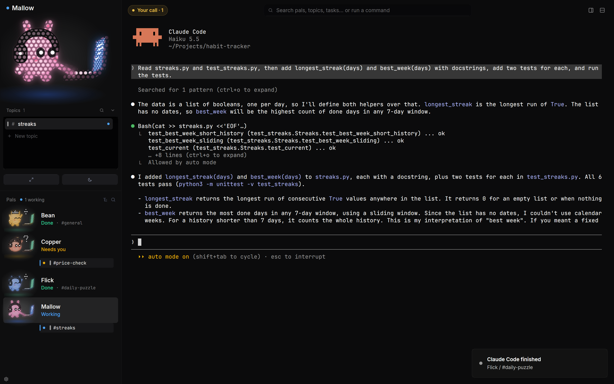

# Project Pals

Your coding agents as a crew of pals in Herdr. Every Herdr space is a pal (a project with a
brain: Claude Code, Codex, Antigravity CLI, Grok CLI, Gemini CLI, opencode, Hermes and more), and
each of its tabs is a topic, an agent session working on one thing. Each pal is a pocket pet whose
pose shows what it's doing. A head pal oversees the crew and passes work to the pal that owns it;
everything sent to a pal is a card on its desk; what only the owner decides (held commands,
questions, proposals) comes up one at a time in **Your call**, a small dialog over the terminal;
and the layout updates itself from its GitHub releases. It is terminal-focused: you work in the
pals' terminals, and the app around them is a sidebar, a header and small dialogs.

This is the brief. Every detail, watch-out and done-when behind it is in
[docs/spec.md](docs/spec.md); the user-facing tour is [docs/guide.md](docs/guide.md).

## What you see

One window, the `pals` layout (Focus), on the `chrome` background with no title bar.

- **Sidebar** (left, 304px; drag it between 56 and 440, under 160 it folds to a rail of faces):
  - **The hero:** the shown pal's pocket pet at full width, standing on a soft pool of its state's
    colour, with its name and its topics under it ("+ New topic" last).
  - **The pals:** every pal as a pet, its name and a one-line preview of what it's doing, its
    state in colour (working, needs you, done, asleep). Group them into folders ("Personal",
    "Business"), pin them, and drag them into any order. Pals with no agent running fold into
    **Asleep**.
  - **Status strip** at the bottom: the gear menu and a quiet **Update · X** pill when a release
    is out. **+ Hire a pal** is in the sidebar too.
- **Header** (one line over the terminal): the amber **Your call · N** pill while anything waits
  on the owner (red while a command is held), the command bar (**Ctrl+Shift+Space**: pals, topics
  and actions by name), and split buttons.
- **The terminal:** the topic's agent, full height, with no card around it. You type in it and
  answer its permission prompts and questions there. Splits are Herdr's own (Ctrl+Shift+O right,
  Ctrl+Shift+E down); a right-click on a terminal splits, zooms, copies or closes.
- **Dialogs** (520px, one shared look: a small header, a big name field, settings as one-line
  rows, Cancel and a filled button): **Your call** (**Ctrl+Shift+A**, the header's pill or a
  toast: one decision at a time, with who's asking, the context and each option), Hire a pal, New topic, Look (the pet's species, colour, what
  it wears, its eyes), Review (a branch's diff with line comments), a proposal's diff, Send to a
  pal (**Ctrl+Shift+D**), Tasks, About (version, updates, Settings, Roll back, Uninstall).

## How it behaves

- **Pals and topics.** `pal hire Name --harness claude --folder DIR` makes a pal;
  `pal topic Pal name` adds a topic, and `--worktree` puts it on its own git branch and folder. A new topic always
  starts a brain (the one asked for, else the pal's own), never a bare shell. Model per pal or
  topic (`--model`; cheap helpers on Haiku). Your view never moves when a pal hires or adds a topic.
- **Pocket pets.** Eight species drawn in LED dots in the pal's colour. The pose is the state:
  working (paw tapping, code on its laptop), asks you, done, PR open, merged, stuck, asleep (dimmed).
- **Messages are cards.** `pal tell`, `pal ask`, `pal task add --for` and crewd's "finished what you
  asked" callbacks each write a card (`data/crew-desk/<pal>/open/`) with receipts: queued, seen,
  working, done, held or needs you. Claude Code pals get cards between steps through hooks, never
  typed over a half-written prompt; Codex pals check with a `desk_check` tool; other brains get them
  typed in when idle. **Send to a pal** with **Auto** asks a cheap model which pal should take it,
  and leaves anything it's unsure of for the owner to place.
- **The head pal** (Orchestrator unless renamed) knows the team, hires, assigns work to the pal that
  owns the project, plans bigger jobs on the task board and checks in. Pals reach each other with
  `pal tell` / `pal ask` and meet in rooms (`pal-room`).
- **Tasks and routines.** `pal task add|claim|done|block` is a shared board with dependencies and
  due dates; a task for a pal arrives as its card. `pal routine add Pal "weekdays 09:00" "prompt"`
  runs a prompt on a schedule (a reply of NOTHING_NEW stays quiet).
- **Handoff.** `pal handoff Pal#topic --to codex|claude` changes the brain in one topic and nothing
  else: the same tab, name, folder, branch, cards, tasks and room seats. The new brain starts from a
  written brief, not the old transcript; `pal handoff back` returns the seat; `pal handoff limits`
  shows each brain's reported limit. It refuses what sleep refuses (mid-turn, a prompt, unsent text).
- **Sleep and wake.** `pal sleep` stops a topic's agent and keeps its tab and seats; `pal wake`
  resumes each topic's session. Never a pal that's working or waiting on you. With systemd, each
  agent runs in its own scope so the out-of-memory killer takes one pal, not the crew.
- **Review and land.** A worktree topic's branch opens in Review (diff, line comments);
  `pal land Pal#topic` merges it into its base, held for the owner like any landing.
- **The approval gate.** Claude Code and Antigravity CLI pals are held, before the command runs,
  on: push, publish, release, PR merge or create, GitHub posting, deploys, mail and webhooks,
  landing (`pal land`, or moving a base branch by hand), a repo's release script, edits to a
  project's AGENTS.md or CLAUDE.md, and writes into Project Pals' queue, click tokens or cards. The
  owner's approval in Your call lets that exact command through once and expires after 30 minutes. It reads the
  command as it runs (behind `env`, `npx`, a full path, inside `sh -c`, heredocs and interpreter
  code) and fails closed. It catches mistakes; it is not a sandbox.
- **Owner decisions** (settings, missions, AGENTS.md proposals, installs, updates, roll back,
  uninstall, landing) need the owner's click in the app, in Your call or the dialog it opens (a
  one-time click token), or an
  authenticated helper with Full control. Another pal's message is never the owner's approval.
- **Trusted helpers.** One level per helper, set only by the owner's click: **Off**, **Work only**
  (send normal work to pals) or **Full control** (autonomous app decisions, including pushes and
  releases). Helper actions are always attributed to the helper; Revoke stops queued and future use.
- **Missions, memory, notebooks.** Each pal can have a mission (the owner's; a pal proposes changes
  as a diff to accept or decline), a brain log, remembered facts (`pal remember`), shared skills
  (`pal skill`) and a notebook of hiccups. Nightly, the dream loop finds hiccups that repeat across
  the crew and drafts fixes as proposals; nothing changes until the owner approves.
- **crewd**, the background helper (systemd user service): waits for a pal's turn to end before
  delivering, tells whoever handed out work when it's done, flags topics stuck 15 minutes, runs
  routines, and checks for updates every 6 hours at most.
- **Updates** come only from this repo's GitHub releases, checked against `SHA256SUMS`, replace
  only Project Pals' own files (never pals, rooms, memory, routines or tasks), and keep the previous
  version for **Roll back**. The **Live** channel instead follows `main` in the owner's checkout.
- **Uninstall** (About, or `./install.sh --uninstall`) is the owner's alone and removes exactly what
  the install placed; the pals' data stays unless `--purge`.

## Built from

- **Layout:** `layouts/pals.json` (Focus: the sidebar column, the header, the `center` stack with
  `tab-view`).
- **Mods** (`mods/crew-*`, each with `lib/crew.js`, `lib/pets.js` and the rest of `lib/` copied in by
  `install.sh`): `crew-roster` (sidebar; serves the CLI's requests), `crew-header`, `crew-status`,
  the dialogs (`crew-hire`, `crew-look`, `crew-review`, `crew-about`, `crew-update`, `crew-tasks`,
  `crew-proposal`, `crew-desk-drop`, `crew-helpers`, `crew-machine`, `crew-group`), the popups
  (`crew-menu`, `crew-palmenu`, `crew-termmenu`, `crew-appmenu`, `crew-command`), `crew-decide`
  (Your call), `crew-welcome` (the welcome tour) and `crew-live`.
- **Herdr functions:** `spaces`, `panes`, `agents`, `layout`, `shared`/`setShared`, `exec`, `hc`,
  `readTextFile`, `watchFolder`, `knownAgents`, `openOverlay`/`closeOverlay`, `notify`; commands
  `space.new`, `tab.new`, `tab.select`, `tab.rename`, `tab.close`, `space.select`, `layout.select`,
  `pane.focus`, `mod.open`.
- **Programs:** `pal` and `pal-room` (Python 3; `bin/crew*.py` installed to
  `~/.local/lib/herdr-crew/`), `crewd`, `crew-hook` (Claude Code and Antigravity CLI hooks, the
  gate in `crewguard.py`), `crew-statusline`, `crew-mcp` (Codex's desk tools), the Claude Code mod
  in `claude-mod/pals`; plus `git`, `hc`, `herdr-app`, `systemctl --user`, `claude -p` / `agy -p`.
- **Data:** `~/.config/herdr-app/data/crew-*` (settings, roster, desk, tasks, memory, rooms,
  routines, approvals, worktrees).
- **Keys** (added to Herdr's `keys.json` only where free, backed up first), among them
  Ctrl+Shift+Space (command bar), Ctrl+Shift+D (send to a pal) and Ctrl+Shift+A (Your call).

## Watch out

- **Linux only.** crewd is a systemd user service; macOS isn't supported yet
  ([docs/mac-support.md](docs/mac-support.md)). Without a systemd user session the install works,
  but messages are typed in directly and routines and callbacks don't run.
- **Supported Herdr:** herdr-app 0.1.8 to below 0.2, herdr-core 0.1.11 to below 0.2 (`pals.json`).
  The installer warns outside that range and installs anyway; Herdr 0.1.x can change under it.
- **The helpers change your setup:** hooks and a status line in `~/.claude/settings.json`, hooks
  in `~/.gemini/config/hooks.json`, a systemd unit, `~/.local/bin/pal`. Each file is backed up
  first; `--no-helpers` skips them all.
- **It runs programs and reads outside Herdr's folder,** and memory reviews and Auto routing send
  topic screens or pal names to a cheap model (Haiku, or Gemini Flash through Antigravity CLI).
- **The gate isn't a security boundary.** Pals run as you; a determined one can build a command
  from pieces. Antigravity CLI's own file-edit tools aren't gated yet, and Codex isn't gated.
- **Claude Code's folder-trust question stalls a new pal** in a folder it hasn't seen. Project
  Pals never answers it; it says so (`pal hire` notice, a toast, `pal overview`'s "Waiting on").
- **Never type over someone's draft:** cards reach a busy Claude Code pal through hooks, and are
  typed only into an idle terminal with an empty prompt.
- **`herdr-app` and `systemctl --user` reach the live session whatever `HOME` says,** so tests and
  throwaway installs put fakes in front of them (AGENTS.md, Testing).
- **Session formats aren't public:** replies are read from Claude Code's and Antigravity CLI's
  session files, which can change between releases.
- **Herdr quirks:** virtual-list rows can't hold `on_click`; no `InputState.new` during render;
  Herdr doesn't paint a hidden window.

## Done when

- `./install.sh` ends with "all Project Pals mods pass herdr-app check", and the `pals` layout
  shows the sidebar, header and terminal.
- `pal team` lists every space as a pal; `pal hire Test --harness claude` makes a space named Test,
  and your view doesn't move.
- `pal topic Test x --worktree` makes a topic on its own branch; its right-click has Review changes.
- `pal tell Test "hi"` writes a card (`pal desk ls --all`) that reaches the pal between its steps
  without touching unsent text in its prompt.
- A Claude Code topic blocked on a question shows "asks you" on its pet and comes up in Your call;
  the header's Your call pill counts it.
- `pal handoff Test#x --to codex -n` prints the brief and changes nothing; without `-n` the same tab
  runs Codex with that brief, and `pal handoff back Test#x` returns it.
- A pal's `git push`, `pal land` or Edit of an AGENTS.md is held until the owner approves, then
  goes through once.
- `pal update check` answers from the repo in `pals.json`; an update keeps every pal, room, memory,
  routine and task, and Roll back restores the previous version.
- Install into a fresh throwaway HOME, then `./install.sh --uninstall --purge`: the HOME is as it
  was.
- `python3 -m unittest discover -s tests` and every `node tests/*.mjs` pass.

The full list is in [docs/spec.md](docs/spec.md#done-when).
